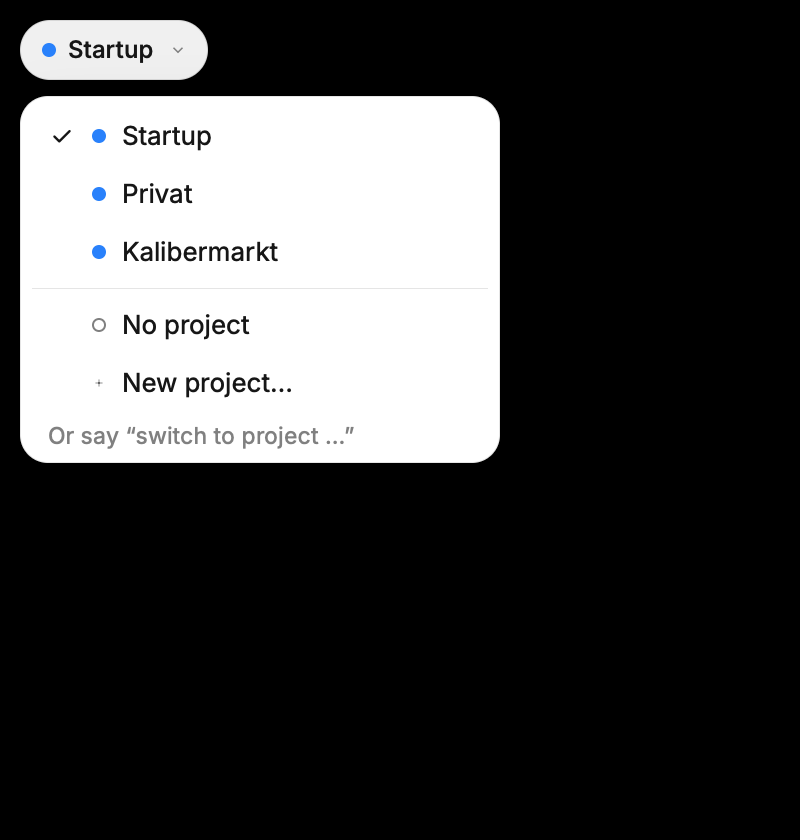
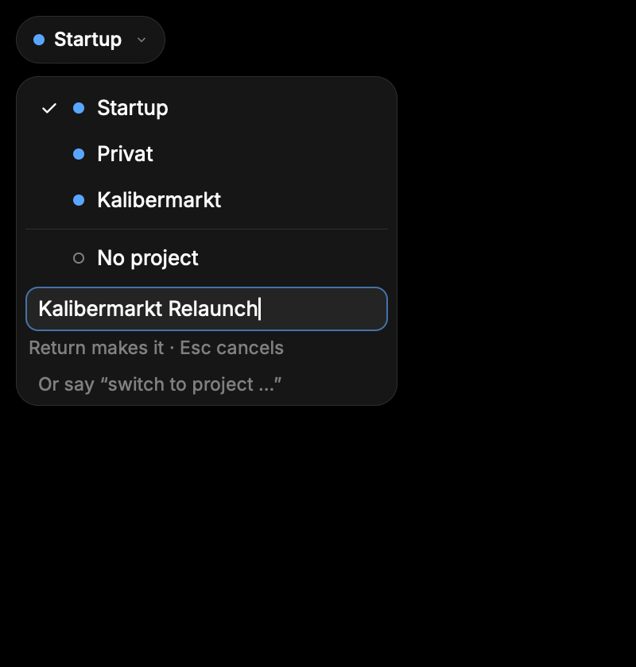
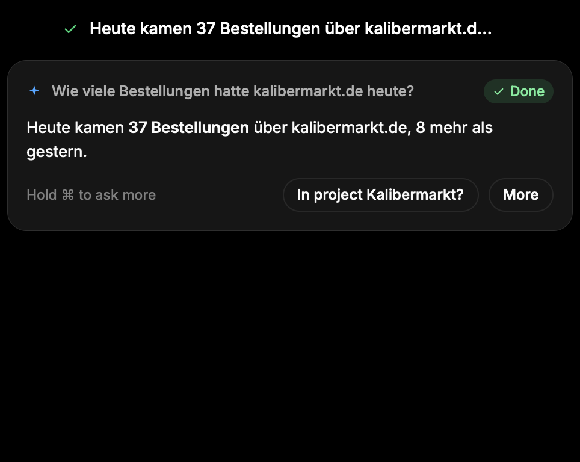
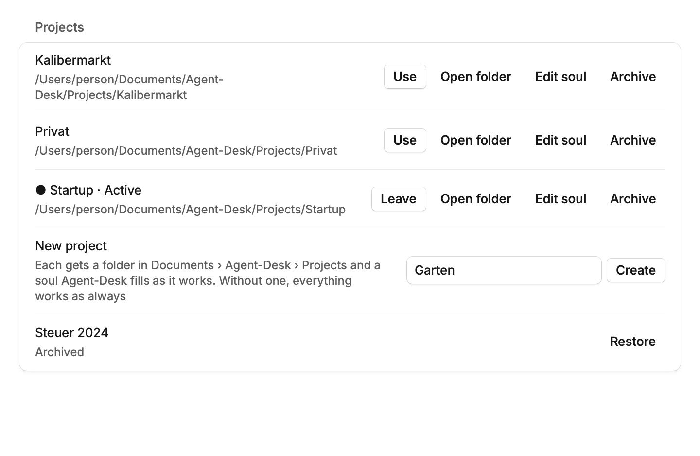

# Assistant

Hold one key and say anything: Agent-Desk decides whether it is a **quick turn**
(answered beside the HUD and read aloud, about the window in front) or a
**job** (worked on in the background, in its own windows and hidden
browsers, beside other jobs). Everything works without opening Agent-Desk's window:
the Here bubble, the orb and its job list, and spoken answers are the
product; the window's **Assistant** pane is one stream of every quick turn
and job, and **Assistant settings** hold the rest.

The assistant is on by default in this fork (`assistant.enabled`, default
`true`; it left Labs, which is gone). Turn it off with the switch at the top
of Assistant settings, the off card's Turn on, or `agent-desk settings set
assistant.enabled false`. `crate::assistant::enabled` is
`assistant::available()` (macOS, Linux, Windows) and the switch;
`assistant::ready` adds `assistant.setup_done`. While it's off, the Action
shortcut, Stop all tasks, the overlays, the scheduler, the menu bar items,
and the onboarding's assistant pages are inert; the Assistant pane stays in
the sidebar and offers to turn it back on. Turning it on before setup is
done opens the assistant's onboarding (`chats::open_setup`), and an Action
shortcut another shortcut took meanwhile is unbound
(`repair_action_shortcut`).

```ts
Assistant           Setting (settings.json, agent-desk settings)    What it does
└── Assistant       assistant.enabled (default on) + assistant.action_hotkey
                    hold the Action shortcut (right ⌘ alone on macOS) and say anything: Agent-Desk answers
                    (quick turn), acts in the window in front, or starts a job; double-tap for the job list;
                    after an answer Agent-Desk listens for a follow-up (conversation_seconds), and speaking over
                    an answer interrupts it on headphones (barge_in); Escape stops quick turns and speech;
                    ⌃⌥Esc (assistant.stop_all_hotkey) stops everything. Both recorders are in Assistant
                    settings › Shortcuts; the Assistant pane is in the sidebar either way
```

## How it fits together

```ts
Action shortcut (assistant::shortcut, per-OS listeners) ─┐
Assistant pane composer (rune_ui::chats) ─────────────────┼─ service::submit ── lanes ── agent::run ── provider (backend)
iPhone replies (assistant::phone), schedules ────────────┘   Here | Background        claude -p | codex exec | opencode | Claude API
                                                                                            │
                     every desktop action ── guard (agent-desk assistant mcp) ── Cua Driver        │
                     web ── browser (agent-browser, one hidden session per task)  ──────────┤
                     Agent-Desk's own tools (tools: remember, schedule, team) and knowledge ───────┘
service::subscribe ── Event ── overlays (rune_ui::assistant_overlay): Here bubble, orb, job list, frame, outlines
                           └── the Assistant pane, notifications, the iPhone, speech
```

1. **Lanes** (`types::Lane`, `service`). A request from the Action shortcut
   starts in the **Here** lane: only the window that was in front, on the
   fast model (`here_model`), answered in the bubble. The brain may hand it
   to the **Background** lane (`Event::Escalated`): a job with its own
   windows and browsers, its plan, its goal check (`agent::goal`), up to
   `max_parallel` at once (`capacity`). A tap-then-hold or "im Hintergrund"
   starts a job directly.
2. **Guard** (`assistant::guard`). Every task's agent gets Agent-Desk's MCP server
   instead of the desktop driver (Cua Driver, `assistant::driver`, the only
   one): window leases (Here holds the front window,
   Background only windows it opened or claimed), real input only when
   allowed, blocked apps, take over, and consent before consequential
   actions (`autonomy`). Prompts are never the only safeguard.
3. **Backends** (`provider`, `backends`). Claude Code, Codex, OpenCode, or
   the Claude API runs the task, each with the guard, the browser, Agent-Desk's
   tools, and `knowledge` (`hex_lookup`). `backends` finds, installs,
   checks, and signs them in.
4. **Overlay** (`rune_ui::assistant_overlay`). `board` turns events into what
   shows: the Here bubble past the HUD, the orb with one dot per job, the job
   list, result bubbles with what to open or Try again, the screen frame,
   window outlines, live browser pictures. `host` makes them Rune panels.
   The Assistant pane (`rune_ui::chats`) shows the same events as one stream.

## Words

| Word | Means | In code | German |
|---|---|---|---|
| quick turn | a request answered in the Here lane, beside the HUD | `Lane::Here`, `Origin::ActionShortcut` | **Frage** |
| job | work in the Background lane, with its own windows, plan, and result | `Lane::Background`, `JobKind::Job` | **Auftrag** (plural Aufträge) |
| task | any running request, quick turn or job | `TaskStatus`, `agent::Job` | Auftrag (for jobs), Frage (for quick turns) |
| Assistant | the window's pane with the stream | `Pane::Chats`, `assistant::lines::ASSISTANT` | Assistent |
| Assistant settings | its settings pane | `Pane::Assistant`, `assistant::lines::ASSISTANT_SETTINGS` | Assistent-Einstellungen |
| orb | the jobs' presence beside the HUD | `assistant_overlay::orb` | – |
| guard | Agent-Desk's MCP server between every task and the desktop | `assistant::guard` | – |

German copy never says „Aufgabe“ for a job: a job is an „Auftrag“, a quick
turn a „Frage“ („Neuer Auftrag im Hintergrund“, „3 Aufträge laufen“). What
the assistant says or shows back to a request (a steer note, "On it", a
job's status, a failure) goes through the interface's translations in the
language of what was said (`assistant::lines`, `desktop::i18n::tr_in`),
never a word list of its own. Every message, menu, and button that sends
people to the window names the sidebar's panes from one constant each
(`lines::ASSISTANT`, `lines::ASSISTANT_SETTINGS`): "Open in Agent-Desk"
behind ⋯ on the stage, "Open Agent-Desk" in the menu bar and tray, "… in
Assistant settings".

## When a quick turn fails

A refused request (assistant off, setup unfinished) emits `Started` before
its `Failed`, so the Here bubble has its question. The bubble reads the
brain's message (`assistant_overlay::failure::Failure::of`) into one of:
off, setup unfinished, not signed in, not installed, missing permission,
usage limit, no credit left (an own-key provider's empty account, which no
wait fixes: `limit::out_of_credit`, never treated as a limit), or anything
else. It shows a short line in the language the
question was asked in, the brain's own words small beneath it when they say
more, and one action: **Fix** (Assistant settings for "off"; the setup's
repair pages, `chats::setup::repair`, for the rest it can fix) or **Try
again** (the same words, in full, in the same conversation). When answers
are read aloud, Agent-Desk also says the line. The bubble stays 12 s. Checks:
`the_brains_messages_have_their_failure_and_remedy`,
`every_line_and_label_has_german` (failure.rs), and
`a_failed_quick_question_says_why_and_offers_one_action`
(assistant_overlay/tests.rs); renders: `bubble-failed-*` in the
`snapshots` test.

## The Action shortcut and Stop all tasks

While the assistant is on, Assistant settings › Shortcuts shows an "Action
shortcut" recorder (`assistant.action_hotkey`, right Command alone by
default on macOS, clearable, with Restore default; also `agent-desk settings set
assistant.action_hotkey right-command`) and a "Stop all tasks" recorder
under it (`assistant.stop_all_hotkey`, ⌃⌥Esc by default, clearable, with
Restore default since Escape ends the recorder; also `agent-desk settings set
assistant.stop_all_hotkey control+option+escape`). They are the same
recorder rows General uses (`general::shortcut_rows`), with their conflicts.
The gates are
`AppSettings::active_action_hotkey` and `active_stop_all_hotkey`: the
assistant enabled (`assistant::enabled`), bound, and sharing no key with
another active shortcut (Stop all also never ⌘⌥Esc, Force Quit, and always
with a key); only then does `RuntimeHotkeys::action` or `stop_all` carry it,
the listener (`recognition::Hotkeys`) run a `Shortcut::Action` machine, and
the event tap swallow Stop all. Off or unbound, nothing is matched,
suppressed, or checked for either, and no key or Escape is taken. Recording
another shortcut refuses their keys while the assistant is on, and they
refuse theirs; one that overlaps when the assistant turns on or settings
load (the dictation shortcut moved onto right Command while it was off) is
unbound (`repair_action_shortcut`).

The machine is the dictation shortcut's (`DictationHotkey`), always in
Hold with double-tap on and `set_double_tap_gesture`, whatever the
dictation shortcut's mode. A press starts a capture at once, with the
dictation HUD, the provisional start tone, chord and short-tap discards, and
the chord breaker; right Command with another key (⌘C) is the app's chord
and discards it, and the key reaches the app. The release finishes it as
`TranscriptionTarget::Assistant`: processed like a paste (vocabulary, modes,
replacements), then handed to the question, never pasted, copied, kept for
Paste last dictation, or saved to History (the conversation keeps it). The
gestures (`recognition::ask`):

```ts
Action shortcut (assistant::ready)
├── Hold, say anything -> Request { conversation:
│   assistant::focus(follow_up_seconds), origin: ActionShortcut, context },
│   the context read by computer::context_async once the hold is real; focus
│   is a task waiting on a question (NeedsInput) first, then a running Here
│   task, then a recent one, so a hold answers or steers (never cancelled
│   here); the brain answers, acts here, or escalates to a background job
├── Optional, never needed: tap, then hold (second press within 300 ms of
│   the tap's release, held past the 300 ms hold threshold;
│   DictationHotkey::follows_tap) forces a Background task: Request {
│   conversation: None, origin: Background, context: default }
├── Here words opening "im Hintergrund", "in the background", "nebenbei",
│   "parallel", or "Hintergrund:" (route::spoken_background; whole words, any
│   case, punctuation around them ignored) -> Background, without them
├── Double tap (both presses shorter than 300 ms, the second within 300 ms
│   of the first's release) -> HotkeyAction::DoubleTap: the second capture
│   is discarded, the task list shows or hides (ask::set_toggle_tasks), and
│   the success sound plays; nothing locks
├── A hold that becomes real -> assistant::service::prewarm(lane), once
├── Words for Here -> speech::stop() before submitting; a press, a tap, or
│   silence leaves the answer being read aloud
└── Not ready (setup unfinished) -> nothing recorded; a hold calls
    ask::set_open_setup's hook (onboarding at its saved page, HUD note)
```

A silent, short, or discarded capture asks nothing. A hold followed by a
quick tap never pairs. The machine that starts a capture owns it, so
dictation and the Action shortcut stand down while the other records; `hex
dictation stop` refuses while a question records (`cancel` still discards
it); a microphone loss mid-question fails it instead of salvaging a copy.
Stop all tasks' press runs `assistant::service::stop_all()` and
`speech::stop()` and plays the cancel sound, once per press (`Asker::key`).

## Conversation mode

Conversation mode (`recognition::conversation`, a pure state machine, and
`recognition::talk`, which carries it out): after a Here answer, or a
question a Here task asks (`Event::Answer` with `Origin::ActionShortcut`,
`Event::Question` for a running Here conversation), once the reading ends
(or never starts within 1.5 s, or `speak_answers` is off) the listener opens
an ordinary capture without a tone and sends
`DictationIndicatorEvent::Listening` for `assistant.conversation_seconds`
(8 s by default; 0 turns it off). Speech (eight 20 ms frames by the
dictation pipeline's `SpeechFrames` test, two quiet frames forgiven) makes it
a question (`Started`, `Asking`, the desktop read, `prewarm(Here)`); 900 ms
without speech (or 60 s) finishes it through the Action shortcut's finish
into the same conversation. Nothing in time closes it quietly. With
`assistant.barge_in` (on by default) the capture opens as Agent-Desk starts
reading: on headphones or AirPods (`audio::output_route` reads Bluetooth,
the headphone jack, and Apple silicon's headphone output) 240 ms of speech
stops the reading (`speech::stop()`) and becomes the follow-up; on speakers,
where the microphone hears Agent-Desk's voice, only speech 6 dB louder than the
answer's own playback level (`speech::level()`) does, and while that level is
unknown (its stub returns `None`) barge-in is off on speakers. Any key going
down or modifier changing ends it before the shortcut it may be can start its
own capture; so do a dictation, a command's capture, a pause, a meeting
recording (`meeting::watcher::recording`), or the setup unfinished. A
microphone loss never salvages its clip. Checks:
`an_answer_then_listening_then_a_follow_up`, `listening_times_out_quietly`,
`shown_answers_and_conversation_mode_off`,
`a_key_or_another_recording_ends_it`, `barge_in_on_headphones`,
`barge_in_on_speakers_needs_a_voice_over_the_answer`,
`a_newer_answer_moves_it_along`,
`without_barge_in_nothing_listens_under_an_answer`, and
`audio_is_heard_in_frames` in
[recognition/conversation.rs](../../src/recognition/conversation.rs);
`only_here_answers_and_questions_are_listened_after` and
`keys_end_conversation_mode` in
[recognition/talk.rs](../../src/recognition/talk.rs). Not yet observed: a
real microphone, the overlays' drawing of `Listening`, or barge-in through
real speakers.

## Speed: two models, kept warm

- **Two models.** A Here turn on Claude Code runs on `assistant.here_model`
  at `assistant.here_effort` (`--effort`, low by default); jobs run on
  `claude_code_model` (none: Claude Code's default). A Here turn on the fast
  model that has made `assistant.escalate_after_tools` tool calls (8; 0
  never) stops between two steps (no tool running, `provider::Escalate`)
  and the strong model goes on in the same session, told
  `agent::ESCALATED_NOTE`; so does one that failed (not on a usage limit,
  not when stopped). Handing work to a job (`hex_start_jobs`) puts it on the
  strong model anyway. OpenCode does the same: a Here turn runs on the
  provider's fast model (`Provider::fast_model`, DeepSeek Flash for
  DeepSeek; `assistant.here_model` instead when it is one of that
  provider's) and hands over to the jobs' model (`opencode_model`, DeepSeek
  V4 Pro) after the same number of tool calls, which OpenCode reports once
  each has ended.
- **Stuck quick turns.** A Here turn whose backend reports nothing (no
  stream line, no tool call or result) for 45 s is ended
  (`agent::watchdog`, `Control::stall`) instead of showing "Thinking…" up
  to its 30-minute limit: on the fast model the strong one takes it over
  once, in its session; if that stalls too, or there is nothing to hand
  over, it fails with "… Try again" (`watchdog::STALLED`).
- **One system prompt per lane and settings.** `agent::system_for` depends
  on the settings and the task only, never on the request's words: the
  person's language and what their words or a yes allowed beyond the
  autonomy mode's baseline go at the top of the message
  (`agent::request_rules`). So the process `prewarm` starts with no words
  (and the memory note, as the request has it) is the one the request
  finds, and the model's prompt cache keeps the rules from one request to
  the next. `each_lane_s_rules_stay_within_their_budget` guards each lane's
  size.
- **Kept warm.** Besides the hold's `prewarm` and the follow-up's process,
  a Here answer starts Claude Code for the next new Here conversation
  (`service::stand_by`), kept `assistant.warm_minutes` (15; 0 off). It
  idles without tokens and serves a hold in any window: a Here task's
  window reaches its guard through the guard's state
  (`guard/here/<task>.json`, written for each request by
  `guard::mcp_server`), not the process's arguments. A reservation is
  matched before it is taken; one a Here request doesn't fit, or one
  replaced by another, ends its process (`provider::end_ahead`) instead of
  idling out its time.
- **Speculative start.** The live transcript of a hold
  (`dictation::audio`, `service::speculate`) starts the reserved
  conversation's own browser once its words ask for the web
  (`route::wants_web`), before the release.
- Measured with `claude -p` stream-json (Claude Code 2.1.323, the Here
  system prompt, cached, no MCP servers; medians of four, seconds from the
  question to its first finished sentence): before, Haiku 5.5 with the old
  prompt, 2.59 started with the question and 2.02 started 2 s ahead; now
  Sonnet 5.5 at low effort with the new prompt, 1.81 and 1.12 (1.21 kept
  warm). Haiku 5.5 at low effort stays at 1.96 to 2.42: it thinks before it
  writes, so Sonnet 5.5 is `here_model`'s default. The Here system prompt
  went from 9,674 to 8,045 cached tokens.

## Whether the shortcuts can work

Whether the shortcuts can work (macOS, `shortcut_conflicts` and
`recognition::shortcut_probe`). `shortcut_conflicts::conflicts(slot,
settings)` checks a saved shortcut against what can take its keys first,
each `Taken` (a saved setting names the same keys) or `Possible` (on or
running, and commonly uses such keys):

```ts
conflicts(slot, settings) -> Vec<Conflict { source, certainty, name, description, fix }>
├── macOS keyboard shortcuts (com.apple.symbolichotkeys)  // Taken; unsaved IDs on with defaults
│   └── Spotlight ⌘ Space, input sources ⌃ Space, Mission Control, screenshots, …; others as "a macOS keyboard shortcut"
├── 🌐 alone vs "Press 🌐 key to" (HIToolbox AppleFnUsageType)   // Taken; unsaved -> Possible
├── Apple Dictation on + a lone ⌘, ⌃, or 🌐 pressed twice     // Possible: its shortcut isn't readable
├── Siri on + a lone ⌘ pressed twice, or ⌘/⌥/🌐 Space held    // Possible; HotkeyTag 0 reads as off
├── Raycast running: raycastGlobalHotkey ("Option-49")       // Taken when it matches; unreadable -> Possible on Space
├── Karabiner-Elements installed: karabiner.json's selected profile
│   ├── a simple modification of one of the keys            // Taken
│   └── a complex rule from one of them                     // Possible
└── running Superwhisper, Wispr Flow, MacWhisper, Spokenly (any shortcut),
    Alfred (a chord on Space), BetterTouchTool, Hammerspoon, Keyboard Maestro (any)  // Possible
```

`shortcut_conflicts::cached` reads again at most every 3 s, for Settings.
While the assistant is on, the dictation shortcut's row in General and the
Action shortcut's in Assistant settings show each conflict under them (red when taken, muted when possible) with where it is
fixed (Keyboard settings, Siri settings, or the app) and "Choose another
shortcut"; no conflict, or the assistant off, draws nothing new. The screenshot
Lab's check (`screenshots::system_shortcut`) reads the same symbolic hot
keys. `shortcut_probe::start(slot, wait)` asks for a press: while it runs
the listener hands every edge to it, not the shortcut machines (nothing
records), and the HID tap reports every key press
(`suppression::set_probing`), so it tells a press and release that reached
Agent-Desk with exactly the keys and sides (`Works { held }`) from a key the
keyboard saw but Agent-Desk's tap never got (`Swallowed`), the wrong modifiers or
side (`WrongKeys`), a missing release (`NoRelease`), and nothing
(`NothingReceived`). It refuses (`Unavailable`) without the listener, while
Settings records a shortcut, or while a recording runs. Checks: the six
fixture-plist tests in
[shortcut_conflicts/tests.rs](../../src/shortcut_conflicts/tests.rs) and the
four in [recognition/shortcut_probe.rs](../../src/recognition/shortcut_probe.rs).
Not yet observed: Raycast's and Siri's saved formats on a Mac that has them
set (neither is set on the development Mac), a real probe, or the notes'
rendering.

## Escape

Escape belongs to the assistant only while a Here task
(`Origin::ActionShortcut`) runs or waits, or an answer is read aloud
(`speech::speaking()`), and nothing records: the tap then keeps it from the
app (`guards::assistant_claims_escape`), and it runs `assistant::cancel` for
each Here task and `speech::stop()`. Jobs and typed requests keep running
(each has its own stop, and Stop all tasks stops them all). Checks:
`a_hold_asks_here`, `a_tap_then_a_hold_asks_in_the_background`,
`a_double_tap_is_a_gesture`, `a_tap_alone_asks_nothing`,
`right_command_with_a_key_is_a_normal_chord`,
`the_action_shortcut_and_dictation_never_share_a_capture`, and
`without_its_machine_right_command_does_nothing` in
[recognition/hotkeys.rs](../../src/recognition/hotkeys.rs);
`a_hold_asks_with_its_lane_settled_at_the_press`,
`the_desktop_is_read_only_once_the_hold_is_real`, `no_words_ask_nothing`,
`the_transcript_submits_and_a_dropped_reply_asks_nothing`,
`spoken_openings_route_to_the_background`,
`words_that_merely_contain_an_opening_stay_here`,
`a_spoken_opening_asks_a_background_task`, `escape_stops_only_here_tasks`,
`the_stop_all_shortcut_presses_once_and_only_while_bound`,
`a_double_tap_calls_the_task_list_toggle`, and `only_a_hold_opens_the_setup`
in [recognition/ask.rs](../../src/recognition/ask.rs);
`escape_is_the_assistants_only_while_it_is_busy` in
[recognition/guards.rs](../../src/recognition/guards.rs);
`an_assistant_question_is_only_answered_never_pasted_or_kept` in
[parakeet.rs](../../src/parakeet.rs);
`the_action_shortcut_needs_the_assistant_and_its_own_keys` and
`stop_all_needs_the_assistant_and_its_own_keys` in
[app_settings.rs](../../src/app_settings.rs); `stop_all_is_a_shortcut_setting`
in [control/settings.rs](../../src/control/settings.rs). Not yet observed: a
real press on a Mac, the recorder rows' rendering (macOS only, so no golden
changes), Escape against a running question, or ⌃⌥Esc reaching Agent-Desk past
macOS.

## The Action shortcut on Linux

The Linux listener (`linux::input`, `linux::dictation`) runs the same
gestures through the shared `assistant::shortcut`. While the assistant is
on, `HotkeyOptions::action` and `stop_all` carry `active_action_hotkey` and
`active_stop_all_hotkey` (Ctrl+Alt+A and Ctrl+Alt+Q by default; a keyless
binding, such as a macOS right ⌘, registers nothing, since Linux shortcuts
need a key), and the listener registers them beside the others, restarting
when they change. X11 grabs them; on Wayland the GlobalShortcuts portal binds
them as `assistant-action` ("Ask the assistant (hold)") and
`assistant-stop-all` ("Stop all assistant tasks"), Hyprland's
`fheuer.agentdesk:assistant-action` and `fheuer.agentdesk:assistant-stop-all`.

```ts
Shortcut::Action (ShortcutState::action_pressed / action_released; always Hold)
├── Press -> HotkeyEvent::Ask { after_tap }: a capture with DictationFlavour::Assistant
│   (same microphone, HUD with Asking { agent: after_tap }, sounds, short-tap discard;
│   no Live typing, never locks or toggles); shortcut::press(after_tap) settles the lane
├── Hold real (MINIMUM_HOLD_DURATION) -> Question::intend, prewarm(lane), once
├── Release -> Finish: shortcut::reply(question) is the capture's print reply, so the
│   transcript is processed like a paste and asked, never pasted, copied, kept for
│   Paste last, saved to History, or kept as a recording
├── Tap, then press within 300 ms of its release -> after_tap (Background when held)
├── Double tap (second press within 300 ms of a tap's release, itself a tap)
│   -> HotkeyEvent::DoubleTap: its capture is discarded, shortcut::double_tap()
└── Not ready (applied_assistant_ready false) -> nothing recorded; the release
    calls shortcut::unready_release(held)
Shortcut::StopAll -> HotkeyEvent::StopAll -> shortcut::stop_all(), once per press
Escape (X11 only) -> HotkeyEvent::AssistantEscape -> shortcut::escape()
```

The Action shortcut and dictation never share a capture (whichever pressed
first owns it). `agent-desk dictation stop` and `toggle` leave a question alone
(`stop --print` answers "not recording"); `agent-desk dictation cancel` discards it.
On X11 the dictation loop refreshes whether the assistant takes Escape
(`claims_escape`, every 100 ms; `linux::input::set_assistant_escape`) and
the listener grabs Escape only then. The portal can't bind Escape, so on
Wayland Escape always stays with the app: use Stop all tasks. Checks: the
`*action_shortcut*`, `stop_all_presses_once_per_press`,
`escape_is_the_assistants_only_while_it_claims_it_and_nothing_records`, and
`dictation_stop_leaves_a_question_alone_and_cancel_discards_it` tests in
[linux/input.rs](../../src/linux/input.rs);
`the_assistant_shortcuts_are_registered_only_while_it_is_on` in
[linux/dictation.rs](../../src/linux/dictation.rs). Not yet observed: a real
press on X11 or through a portal, or the HUD's Asking look on Linux.

## Windows

The Windows listener (`windows::input`'s keyboard hook, `windows::dictation`'s
loop) runs the Action shortcut and Stop all tasks through the shared
`assistant::shortcut` while `active_action_hotkey` and
`active_stop_all_hotkey` return them (right Ctrl alone and Ctrl+Alt+Esc by
default); settings changes restart the hook with them.

```ts
Action shortcut (Windows; DictationFlavour::Assistant, its own capture)
├── a modifier alone (right Ctrl) or a key chord; always Hold, whatever the
│   dictation shortcut's mode; no lock, no Toggle cancel key
├── hold -> Here question: shortcut::press(false) at the press, intend() and
│   service::prewarm(lane) once the hold is real, shortcut::reply(question)
│   as the capture's print reply at the release; the HUD gets
│   Asking { agent } after Started
├── tap, then press within 300 ms and hold -> Background (after_tap)
├── two taps under 300 ms, the second within 300 ms -> HotkeyAction::DoubleTap:
│   the capture is discarded, shortcut::double_tap()
├── right Ctrl with another key or button (Ctrl+C) -> the capture is
│   discarded and the key reaches the app; right Ctrl starts nothing until up
├── processed like a paste (modes, vocabulary, replacements), never pasted,
│   copied, kept for Paste last dictation, or written to History
├── not ready (applied_assistant_ready false) -> nothing records; the release
│   calls shortcut::unready_release(held_for)
└── owns its capture: dictation shortcuts never finish it, nor it theirs;
    `agent-desk dictation stop` refuses while it records, `cancel` discards it
Stop all tasks -> its key swallowed (repeats and release too), once per press;
    shortcut::stop_all() on the listener's loop, not the hook's thread
Escape -> taken (down, repeats, up) only while shortcut::claims_escape(bound,
    nothing records), refreshed every loop turn; shortcut::escape()
Tray (shared tray_menu, Windows) -> while assistant::enabled: Stop all tasks
    (disabled under its own id while nothing runs) and Open Agent-Desk
```

Checks: `an_action_hold_asks_here`,
`an_action_tap_then_hold_asks_in_the_background`,
`an_action_double_tap_is_a_gesture`, `right_control_with_a_key_is_the_apps_chord`,
`an_action_key_chord_is_held_and_swallowed`,
`the_action_shortcut_and_dictation_never_share_a_capture`,
`stop_all_presses_once_per_press`, and
`escape_is_the_assistants_only_while_claimed_and_nothing_records` in
[windows/input.rs](../../src/windows/input.rs) (compile-checked from Linux,
not run); `tray_menu_ids_round_trip_and_show_the_state` in
[desktop/tray_menu.rs](../../src/desktop/tray_menu.rs). Not yet observed: any
of it on Windows. Open Agent-Desk opens the window on the Assistant pane
(`rune_ui::show` with `Destination::Chats`).

## The Assistant pane and Assistant settings

The window's **Assistant** pane (`Pane::Chats`, `rune_ui/chats`; the module
keeps its old name) is in the sidebar on every desktop
(`chats::available`), whether or not the assistant is on. While it's off it
shows a calm "The assistant is off" card with Turn on (`chats/switch.rs`)
and a running onboarding closes. It is one stream (`chats::stream`): every
quick turn, answer, and job in one timeline, oldest at the top; jobs as live
cards with their plan, question, and results (folder, files, sheet); the
running tasks in a strip with Take over, Hand back, Stop, and Stop all. One
composer asks anything new (the assistant knows the whole stream and
routes it), or, after a click on an entry, replies to it or steers it
(`Request { origin: Chat, conversation }`; Return sends, Shift-Return starts
a line). Answers render as Markdown, streaming while `AnswerDelta`s arrive.
The entry showing is named with `assistant::set_focus` and cleared when the
pane or window goes. `agent-desk://chats?id=<conversation>`, the menu bar's and
tray's "Open Agent-Desk", a notification's own "Open Agent-Desk" action, and
"Open in Agent-Desk" behind ⋯ on the overlay's stage
(`assistant_overlay::set_open_chats` → `window_link::open_chat`) open it.

### The window recedes: the stage

The window opens only when the person asks (docs/ux/redesign.md §5).
Everything the assistant shows by itself is projected on the overlays, on
the **stage** under the island (`assistant_overlay/stage.rs`,
`host/stage.rs`, 640 wide, on the display under the pointer):

- A long Here answer: the bubble's **More** projects it in full (Markdown,
  scrolling with the wheel, ↑ ↓ and Space; never cut), with Copy, Save as
  note (`~/Documents/Agent-Desk Notes`, shown in Finder), pin, and what it
  names to open.
- A job's result (a notification's click, More on its result bubble, a
  press in the orb's Done group): the headline, the rest as a preview, its
  files, folders, and links as rows with their verbs (Open, Show, Open in
  Finder, Open link), What it did (its steps, and the job's own log file),
  Try again on a failure.
- What it did on the enlarged live card (its steps, not the window).
- The repair check (every five minutes) never switches the window to the
  guide: a small card says what's missing again, once per new set, with the
  fix it can do in place (one System Settings pane, the agent's sign-in),
  Later, and Fix all… (the guide, in the window: a press).
- A hold before setup says "Finish setting up" in the bubble with Continue
  setup (the press opens the guide); "Turn on" on a quick turn that failed
  because the assistant is off switches it on in place.

It folds away 20 s after nobody looks at it (never while pinned, pointed
at, or read aloud). While it shows a result, a short spoken "open the
folder", "show the file", "öffne den Ordner" acts on it there instead of
going to the agent (`stage::spoken`, from `recognition::ask`). Checks:
`only_explicit_entry_points_open_the_window` (every caller of the window's
openers on an allow-list, [code_shape_tests.rs](../../src/code_shape_tests.rs)),
`a_hold_before_setup_does_not_open_the_window` and
`a_notification_click_shows_the_result_on_the_stage`
([window_link.rs](../../src/rune_ui/window_link.rs)),
`the_repair_check_never_switches_the_window`
([chats/tests.rs](../../src/rune_ui/chats/tests.rs)), and the stage's own
in [stage_tests.rs](../../src/rune_ui/assistant_overlay/stage_tests.rs)
(renders: `assistant-stage-*-{light,dark}.png` from the ignored
`stage_snapshots`).

**Assistant settings** (`Pane::Assistant`, `chats::settings`; also
`agent-desk://settings/assistant`): the switch first ("Hold right ⌘ to ask,
double-tap for your tasks") and Run setup…; Shortcuts (the Action and Stop
all recorders); Agent & model (the agent picker, its model, the quick
turns' model); How it works (autonomy, how long a job may run, waiting out
usage limits, Tasks at once, keeping the Mac awake); Apps & windows
(operating apps; real input, one switch per lane: `here_physical_input`
for the window in front, `background_physical_input` for jobs; full
control of this Mac, `full_control`; the screenshot with a quick turn;
displays; parking job windows, `park_windows`); blocked apps; web (the
hidden browser and the sites jobs may use signed in); Voice, with one
Follow-ups row for both follow-up windows (Listen, `conversation_seconds`:
answer back without the shortcut; Continue chat, `follow_up_seconds`: a hold
that soon continues the chat); Notifications; On my iPhone; and Memory.
Renamed keys still load and `agent-desk settings` still takes them:
`background_front_window` is `full_control`, `agent_space` is
`park_windows`, `physical_input` is `background_physical_input`.

## Projects

An optional workspace for a part of the person's life or work („privat“,
„Startup“, „Kalibermarkt“), `assistant::projects`. Without one active,
everything runs exactly as before; questions and jobs never need one.

- **On disk**: `~/Documents/Agent-Desk/Projects/<Name>/` with `soul.md`
  (Goal, People, Websites, Repositories, Accounts, Tone & preferences, Key
  files, Decisions, Recently learned — Markdown the person edits; headings
  in the interface language, recognised in any), `project.json` (id, name,
  archived, and the keys of everything ever learned on its own, so a pruned
  line never comes back), `files/` for what tasks make, `Jobs/` for its
  jobs' own folders. A folder made in Finder there is adopted. Which one is
  active (and the recent ones) is `<support>/assistant/projects.json`.
- **Choosing**: the rail's chip („● Startup“; with nothing at work, the chip
  alone) opens a picker (recent projects, No project, New project… typed in
  place); by voice „wechsle zu Projekt Startup“, „neues Projekt
  Kalibermarkt“, „ohne Projekt“, „welches Projekt?“ (and English), answered
  by Agent-Desk itself (`projects::command`, `service::project`), never an
  agent; Assistant settings › Projects (Use/Leave, Open folder, Edit soul,
  Archive, Restore, Create); the agent's `hex_project` switch/create only
  when asked. While the shortcut is held, the island's trail names the
  project the words go to.
- **A task in a project**: a new conversation takes the active project, a
  conversation keeps the one it started in (`Stored.project`), a helper its
  lead's. Its message (never the system prompt, so a warm backend stays
  warm) carries the soul's relevant part, at most `BRIEF_CHARS`: lines
  sharing words with the request first, then each section, Recently learned
  newest first. A job's folder is made in `Jobs/`. Memory-graph links
  learned in it are tagged with the project; recall in a project leaves
  other projects' links out (global ones stay everywhere). Job rows in
  another project than the active one wear a small tag.
- **Collecting**: after an answer, sites, repositories, and addresses the
  person named, links in the answer that carry the project's name, and up
  to five files the job made go under Recently learned (deduplicated, never
  anything that looks like a secret). The agent adds facts with
  `hex_project` (action learn: people and roles, sites, accounts, goals,
  decisions); a background job may only learn and read, the person's own
  turn may also update a section, switch, and create.
- **Offer, never a silent switch**: with no project active, a request that
  names a project's site, repository, address, a person's full name from
  its People, or its name gets „In project Startup?“ on the Here bubble;
  one tap makes it active for the next requests.

| Picker | New project | Job in another project | Offer | Settings |
|---|---|---|---|---|
|  |  |  |  |  |

Renders: `AGENT_DESK_PROJECT_SNAPS=<folder> cargo test --bin agent-desk
project_snapshots -- --ignored` and `settings_projects_snapshots`.

## On my iPhone (away mode)

Assistant settings › On my iPhone (`assistant.phone_enabled`, off by default) sends a
task's questions and approvals, its failures, and Background jobs' results as
an iMessage to the person's own number or Apple ID (`assistant.phone_handle`)
while they're away: the "I'm away now" switch, the screen locked, no input for
`assistant.phone_away_minutes` (0: never by idle), or a request that says
„ich gehe jetzt …“ (until input comes back). Sending scripts Messages
(Automation permission for Messages, asked when the switch turns on).

Replies are read from `~/Library/Messages/chat.db` (read-only, Full Disk
Access; the row offers System Settings) every 4 s while away: only incoming
rows from that handle, only after away mode began. „stopp alle“ stops every
task, „stopp“ the one whose question waits, „status“ sends the tasks' state
back, anything else answers the waiting question or starts a request as if
typed in the Assistant pane. Message text is never logged. Code: `src/assistant/phone/`.

## Onboarding

One short flow (`chats::setup::Page`), with a segmented progress bar and
"Step 2 of 8 · Permissions" over each page:

1. **Welcome**: what Agent-Desk does on one screen (hold to ask, a bigger
   job, every task, the Assistant stream) and three lines on what leaves
   the Mac and what never does.
2. **Permissions** (`sheet/permissions.rs`): one checklist with live state:
   Accessibility, Screen Recording, Microphone, Automation, Contacts,
   Reminders and Calendar, and Full Disk Access (optional). One button per
   row; the row turns into a green check when macOS reports it; "3 of 5
   allowed" under the card.
3. **Agent**: who answers, installed and signed in.
4. **Cua Driver** (`sheet/desktop.rs`): the driver, which display agents
   work on, and the self-tests ("Making sure it works"), run on arrival.
5. **Web tasks** (optional): agent-browser; says "Optional" and is skippable.
6. **Voice**: the Action and dictation shortcuts are free and a press
   reaches Agent-Desk.
7. **Try it out**: hold the Action shortcut and ask.
8. **Done** (`sheet/done.rs`): every step ready or left, Go to for each one
   left, and Finish.

How freely it acts, the blocked apps, and what it knows about you are no
longer pages: they live in Assistant settings (the old Privacy and "Tell
Agent-Desk about you" pages). Saved progress on a removed page resumes on
its new home (`Page::named`). The repair guide uses the same pages; the
Permissions checklist then shows only the rows still missing, under a
notice listing what changed. Scenes: `mac-assistant-setup`,
`-permissions`, `-agent`, `-desktop`, `-browser`, `-shortcut`, `-try`,
`-finish`, `-done`, `-repair`.

The details below predate the merge where they name the old page order.

The assistant's onboarding (`chats/setup.rs`, drawn by `chats/sheet.rs` in
the first run's type, card, and motion over the whole window) opens when
the assistant is turned on (Settings' switch or the off card's Turn on)
while `assistant.setup_done` is false, after the voice first run on a fresh
install, and from Run setup… or the Assistant pane's notice. Pages: Meet your assistant; Choose who answers (the
agents `backends::detect` found, Claude Code by default, each with its fix:
install, sign in, start OpenCode, or the API key); Agent-Desk's Microphone,
Accessibility, and Screen Recording, each Allow opening its System Settings
page with Agent-Desk's guide and waiting until macOS reports it on (read every
1.5 s); Automation for System Events and Finder (one macOS prompt each;
any other app a task scripts asks on first use, and the task's step says
so first: `automation::first_use_notice`); Cua Driver, installed with one
click if missing (a checked download), with its version and update status
and an Update button (it acts with Agent-Desk's own grants); Contacts, Reminders, and the
Calendar in one row whose Allow shows macOS's prompt for each never
answered (`desktop::data_access`; a refusal stays the person's answer and
only System Settings turns it on), and optional Full Disk Access (Mail and
Messages; System Settings only). The page waits until each of macOS's
prompts was answered, yes or no; the self-tests (`backends::self_tests`), run on arrival, with
each failure's fix; the Action and dictation shortcuts, with what else takes
them (`shortcut_conflicts::conflicts`, read again every 3 s, each with where
it's fixed and, for the Action shortcut, Choose another…) and a live press
test of each (`recognition::shortcut_probe`; ✓ only when the press and its
release reached Agent-Desk, and a swallowed press names the app that took it), the
page waiting for a free Action shortcut that works (`chats/shortcut.rs`
adapts both); then the try-it: hold the Action shortcut and ask, waiting
for one real spoken question, answered. A row shows ✓ only after its check saw
it work. Continue waits for its page; Later moves on and marks it unfinished
(amber in the progress marks). Finish waits until the chosen agent answers
and can use the desktop tools, then sets `assistant.setup_done`. Menu bar: Stop
All Tasks and Open Agent-Desk show only while the assistant is on. Checks:
the tests in [rune_ui/chats/tests.rs](../../src/rune_ui/chats/tests.rs),
`reads_chats_links` in [deep_link.rs](../../src/rune_ui/deep_link.rs), and
`the_assistant_rows_start_hidden_and_do_something` in
[status_item.rs](../../src/macos_rune/status_item.rs); scenes `mac-chats*`
and `mac-assistant-setup*` (macOS only, so no golden changes). Not yet
observed: the live service, real grants, or a real question on a Mac.

The release check's `onboarding_walkthrough` in
[onboarding_check.rs](../../src/rune_ui/tests/onboarding_check.rs) downloads
the recommended speech model in an isolated data folder, follows the default
assistant handoff after the voice practice, closes its setup for later, and
still requires “Agent-Desk is ready” before finishing. This checks the window's
flow, not live assistant setup or a real spoken question.

The assistant's setup keeps Back clear of macOS's native window controls.
Its content scrolls independently below the header, so a long checks page
or the website form remains reachable in a short window.

```ts
Optional website sign-in
├── Add website → enter a web address → Open website
│   └── opens that address in Agent-Desk's dedicated browser, once per pending request
├── Sign in there → Save browser data → closes the browser and refreshes saved domains
│   └── a failed save stays open and can be retried
└── Saved browser data ≠ a verified login; each website can expire or reject it

macOS permissions
├── Allow → the running app's native permission guide and macOS registration
├── Granted but requires relaunch → Restart Agent-Desk and continue
├── Old entry remains unusable after returning from Settings → Repair permission entry
│   └── explicit action resets that permission for the running bundle and reopens its guide
└── A grant changes on Checks → refresh affected desktop checks
    └── keep the unrelated agent/browser results; dependent checks wait for prerequisites
```

Sources: `chats/site_sign_in.rs`, `assistant/browser.rs`,
`chats/setup/permissions.rs`, `chats/sheet/{browser,checks,desktop}.rs`, and
`macos_host.rs`. Browser-state summaries read domain names, never display
cookies or tokens, and do not import the person's normal browser profile.
Available checks: `onboarding_polish_*`,
`a_selected_sign_in_site_opens_once_and_failed_saves_can_be_retried`,
`stale_assistant_grants_use_the_running_apps_permission_repair`, the browser
URL/storage unit tests, and the named macOS assistant setup scenes. These fixture checks do not establish a real website login or
that macOS granted a live app access; the native permission checks remain
authoritative and are never forced green by the window.

### Back for what's missing

After setup was finished, Agent-Desk checks at launch and every five minutes
(`desktop::setup_gaps`, read off the window's thread by `Job::Gaps`):
Microphone, Accessibility and Screen Recording, Automation (System Events
and Finder), Contacts, Reminders, or the Calendar never asked for (so an
update that adds an ask shows the permissions page once), a translocated or stray copy
(`permission_doctor`), the speech model, the chosen agent installed and
signed in, Cua Driver (installed; its last update didn't fail), agent-browser, the Action shortcut
still free, the Agent-Desk voice's files, and `assistant.setup_version` against
`SETUP_VERSION` (pages a release adds go in `setup_gaps::ADDED`). When
something is missing, the onboarding opens on just the pages that fix it
(`chats::setup::repair`), headed "Agent-Desk needs your help for a moment" with one
line per gap, moves on by itself once a page works, and ends after the last.
Later or Close puts it off until Agent-Desk next starts. A missing Agent-Desk voice
downloads again without a page. While something essential is missing (a
copy macOS can't grant, Microphone, Accessibility, the agent), a hold of the
Action shortcut says what in the HUD instead of asking and opens the guide.
Scene: `mac-assistant-setup-repair`.

## Cua Driver, the desktop driver

Every desktop action runs through Cua Driver (`cua-driver mcp --direct`,
MIT, by Cua AI) behind the guard; there is no other driver and no
fallback. The guard serves its tools as `desktop_*` (`guard/cua.rs`), and
it runs in Agent-Desk's process tree, so it acts with Agent-Desk's own
Accessibility and Screen Recording, with its telemetry and its own update
checks off (`driver::cua::env`). macOS only.

- **Install** (`driver::cua`): the first install takes the pinned release
  (`cua::PINNED`, checksums compiled in) into
  `<support>/assistant/cua-driver/<version>/`, checks the archive's
  SHA-256, the app bundle's and the executable's Developer ID signature
  (team `YCK386LBJ7`), and the bundle's notarization (`spctl`).
- **Updates** (`driver::update`): once a day in the app (`start_daily`,
  from `guard::startup`), from setup's and the repair guide's *Update Cua
  Driver*, and `agent-desk assistant driver update`, Agent-Desk reads Cua's
  releases (`trycua/cua`, tags `cua-driver-rs-v<x.y.z>`; nightlies and
  drafts don't count; GitHub marks them all pre-release). A newer one is
  downloaded and its SHA-256 checked against the release's `SHA256SUMS`,
  `checksums.txt`, and GitHub's digest (all must agree); its signature must
  name the team of the installed, trusted driver, and it must be
  notarized. It is unpacked beside the current one and self-tested
  (`guard::driver_self_test`: it starts, answers MCP `initialize` and
  `tools/list`, and lists Finder's windows). Only when no task acts
  (`idle_in_app`: no task runs, no window is leased, no real input) does
  `current` switch, in one rename; it is tested again where tasks run it,
  and a failure there goes back to the previous version. The previous
  version is kept for `agent-desk assistant driver rollback`; older ones
  go. A task keeps the driver it started with (its spec names the path).
- **Status**: `<support>/assistant/cua-driver/update.json`, shown as
  "Cua Driver 0.49.3 · up to date / updated from … / update failed (kept
  …)" on setup's permissions page, in the Checks' detail, and by
  `agent-desk assistant driver`; a failed update is a repair-guide gap
  (`Gap::DriverUpdate`).

## OpenCode and your own API key

Two programs answer to `opencode`, and `backends::opencode` tells them
apart by `--version` (remembered per executable until it changes on disk):

- **OpenCode 2** (`@opencode/cli`, `anomalyco/tap/opencode-v2`, the
  `opencode.ai/v2` installer; `0.0.0-dev/beta` builds too), which Agent-Desk
  installs: `opencode run --standalone --format json --auto --archived`,
  providers in the config as `providers.<id>.settings`.
- **Classic OpenCode** (1.x and the 0.x before it: `opencode-ai`,
  `~/.opencode/bin`, Homebrew's `opencode`): no `--standalone` or
  `--archived` (it prints its help and fails), and it rejects a config
  with `providers`; it gets `opencode run --format json --auto --title
  Agent-Desk` and `provider.<id>.options`. Its sessions show in the
  person's own list, titled Agent-Desk.

Tasks, the three self-tests (`check::answer`, `check::browser`,
`check::driver`, through `providers::opencode_check`) and the readiness
check's `opencode models` all build their arguments there.

**Bring your own key.** `backends::providers` lists the providers OpenCode
knows (DeepSeek first) with their key page, default and fast model, and a
tiny request that proves a key (DeepSeek's `/user/balance` also says the
balance). The key is kept in the Keychain (`provider:<id>`), handed to the
task's process only, by environment, and named by reference in the config
(`{env:DEEPSEEK_API_KEY}`). Setup's agent page saves it; so does
`agent-desk assistant provider-key deepseek` (the key on stdin; `--list`,
`--check`), and `agent-desk assistant ask --provider deepseek "…"` runs one
task with it. A wrong key fails as "not signed in" (Fix), an empty account
as "no credit left" (Fix, never waited out as a limit). Verified end to end
on 2026-11-13 with DeepSeek on OpenCode 1.19.5 and 2.3.0: quick turns, a
job with the hidden browser, the own-key path, a wrong key, and a hand-over
from Flash to V4 Pro.

## Web accounts in the hidden browsers

Every task's hidden browser starts from a read-only copy of one sign-in
state (`browser::accounts`): the cookies of a Chrome profile, taken over
in Assistant settings › Accounts and again every day, or sign-ins made by
hand in Agent-Desk's own window. **Google and YouTube never come over from
Chrome** (`accounts::kept_in_chrome`; only their consent cookies do):
Google binds a session to its browser and ends it everywhere once it sees
it used from a second one, so twenty hidden Chromes with a copy of the
person's Google session signed them out of Google and YouTube in their own
Chrome when agents started. A sign-in by hand in Agent-Desk's window is a
session of its own and leaves Chrome's alone. A state an older import left
with Google's cookies is cleaned once on launch
(`accounts::keep_google_out`, recorded as `google_kept_out` in
`browser-import.json`).

## Agents on Linux and Windows

The agent backends (Claude Code, Codex, OpenCode, agent-browser) run the
same way on every OS; what differs (Cua Driver, the desktop driver, is
macOS only: elsewhere tasks answer without using apps):

- **Process trees** (`backends/run.rs` `own_group`/`Tree`): Unix puts each
  agent in its own process group (on Linux a helper Agent-Desk waits for also gets
  `PR_SET_PDEATHSIG`); Windows puts it in a Job Object (shared with
  `personal_commands/process.rs`) that Cancel, steering, and a failure end
  at once, and that ends everything if Agent-Desk dies. A normal exit releases the
  job, so a daemon an agent left on purpose (agent-browser's) keeps running,
  as on Unix.
- **Finding programs** (`backends/search.rs`): Linux asks the login shell
  (bash, else sh, when `$SHELL` is unset) and adds Linuxbrew, pnpm, snaps,
  and `~/.npm-global/bin`. Windows has no shell to ask: the PATH comes from
  the registry (machine, then user, `%VAR%` expanded), plus npm's
  `%APPDATA%\npm`, WinGet's links, `%USERPROFILE%\.local\bin`, Bun, Scoop,
  pnpm, Volta, fnm, nvm-windows, `%ProgramFiles%\nodejs`, and System32.
  `name.exe` beats an npm `name.cmd` shim, and a shim runs as the
  `node.exe <script>` (or `.exe`) it wraps (`search::launch`), in Agent-Desk's own
  commands and in the MCP server configs given to agents, because batch
  files can't take the newlines and quotes in the agents' arguments. MCP
  servers get `SystemRoot`, `PATHEXT`, `ComSpec`, `APPDATA`, `LOCALAPPDATA`,
  `USERPROFILE`, and the other variables Windows programs need besides PATH.
- **Installs** (`backends/install.rs`, `Os`): macOS is unchanged
  (Homebrew, npm, script). Linux uses Claude Code's native script, then npm
  (into `~/.local` when npm is the system's), then the project's script,
  then a Linuxbrew formula. Windows uses `winget install
  Anthropic.ClaudeCode`, else npm (`@openai/codex`, `@opencode/cli`,
  `agent-browser`), else the project's PowerShell script.
  Lightpanda has no Windows build: its install and self-test are hidden
  there. "Copy install command" quotes for PowerShell on Windows and joins
  with `;`. Sign-in opens Terminal on macOS, the desktop's terminal on Linux
  (`xdg-terminal-exec`, `x-terminal-emulator`, GNOME Terminal, Konsole, …),
  and a console window on Windows.
- **Sandboxes**: Claude Code's job shell is sandboxed on macOS and, with
  bubblewrap and socat installed, on Linux. Without a sandbox (Windows, or
  Linux without them) a job gets no shell (`Bash` denied, file tools still
  scoped to the workspace), and the self-test says so. Windows permission
  rules use Claude Code's `//c/Users/...` form. Codex uses its unelevated
  Windows sandbox. In **Yolo** (`assistant.autonomy = "yolo"`) a job has
  no sandbox at all: Claude Code runs with `--permission-mode
  bypassPermissions` and Bash, Codex with `sandbox_mode="danger-full-access"`,
  OpenCode with `external_directory: allow` — every folder, the whole
  network, and the person's tools (git, gh, npm, tailscale, …), and the
  guard and browser never ask for a yes.
- **Autonomous jobs** (`agent::goal`): a job writes `## Done when` in its
  `plan.md`; when it answers, an independent check (a fresh session of the
  same backend, told to change nothing, its steps neither shown nor kept)
  verifies each criterion and answers `HEX_VERIFIED` or `HEX_NOT_DONE:` with
  the gaps, which go back to the job until it is verified, it asks the
  person (`HEX_QUESTION`, after rounds without progress), or it wraps up.
  In-between answers aren't streamed or spoken. Jobs run on
  `job_budget_minutes` (7 days by default; questions and chats keep
  `task_timeout_minutes`), keep retrying usage limits for their budget, and
  resume by themselves after Agent-Desk restarts or crashes. Asked by voice
  ("Wie weit ist der Shop?", "status"), Agent-Desk tells each job's plan progress,
  time, and last check (`service::status`) without running an agent.
  `hex_compare_images` gives jobs a screenshot similarity score.
- **Long jobs** (`agent::{journal, rollover, recovery, long}`): a job keeps
  `journal.md` in its workspace, its memory across sessions and restarts.
  The agent appends what it learned, decided, tried (`- tried: <step> ·
  <method> · failed: <why>`), and what is open; Agent-Desk adds `hex:` lines
  for the start and budget, each plan step ticked (a milestone, once), a
  ticked step whose `check:` names files that aren't there, fresh sessions,
  resumes, waits, and the final check (its exact record is
  `.hex-journal.json`). Each plan step ends with `— check: <proof>`, run
  before it is ticked; a failed check switches strategy instead of
  repeating. Claude Code reports the session's size between steps
  (`Report::Usage`); past 140k tokens, 250 steps, or steps three times
  slower than at the start, Agent-Desk ends the session between two steps
  (`Control::rotate`) and goes on in a fresh one seeded with the request,
  `plan.md`, the journal's newest lines, what is open, what failed, the
  browsers' last pages, and the time used and left. A resumed job (restart,
  usage limit) is told the same, in a fresh session when its saved one was
  already too large. A lost network (`recovery::classify`) waits until the
  service answers again (up to 6 h), and a backend that ended without an
  answer (sleep, lock screen) goes on in its session, up to six failures
  in a row without a step between them. With less than a tenth of its
  budget left a job is told to secure what is done and wrap up.
  `agent::run_with` takes an `Engine` (backend, clock, network), so
  `long_tests` simulates an eleven-hour job that rolls over four times,
  loses the network, crashes, and resumes, redoing nothing.
- **Knowing the person's things** (`assistant::knowledge`): `hex_lookup`
  (query + scope: files, recent_files, contacts, calendar, reminders, mail,
  browser_tabs, browser_history, apps, memory, all; `chrome_tabs` and
  `chrome_history` still parse, for one release) answers from Spotlight,
  Contacts (`knowledge.swift`, else the address book's database), EventKit,
  Mail's Envelope Index and the browsers' history (every Chromium-based
  browser's profiles, found by their `Local State` + `<profile>/History`
  layout, and Safari's `History.db`; read from a clone, Full Disk Access),
  and the tabs of the person's default browser (LaunchServices' `https`
  handler; JXA, never launching it), ranked and bounded; never message
  bodies, cookies, or passwords. `hex_browser_tab` (`hex_chrome_tab` still
  answers, for one release) reads and acts in the tab the person means in
  that browser, scripted by the family its own dictionary speaks: Chromium
  (`execute … javascript`) or Safari (`do JavaScript`); no list of brands.
  A read falls back to fetching the URL. Its clicks, fills, and navigations
  go through the one autonomy gate (`autonomy::Gate`); `run` only reads the
  page (`knowledge::script::read_only`: an allowlist of names, no
  assignment, no computed members) unless YOLO on the person's own turn; a
  background job only reads there unless YOLO.
- **One autonomy gate** (`autonomy::Gate::check(category, target)`): the
  guard's clicks and shortcuts, Agent-Desk's browser, the person's browser tab, and
  app scripts all ask it, and every refusal has one `NEEDS_CONFIRMATION`
  shape (`autonomy::Refusal`: code, message, details {category, target,
  tool, mode, app}).
- **App actions run no code outside YOLO** (`actions::app_action::vet`):
  every app a script addresses (`tell application …` after an `end tell`,
  `application id`, a path, `«class capp»`, JXA `Application(…)`) is checked
  against the blocked apps and the gate; outside YOLO a script that runs
  shell commands (`do shell script`, `do script`), other scripts (`run
  script`, `load script`), raw `«event …»`, the Objective-C bridge,
  JavaScript in a browser, direct file writes, or keystrokes, that names an
  executable, or that addresses an app by a computed name is refused
  (`RUNS_CODE`), as is any action for an app whose `Info.plist` says it
  opens shell scripts (a terminal) and an `open_url` of a local program,
  script, or link file. YOLO runs everything but blocked apps.
  The memory graph (`knowledge::graph`, `memory-graph.json`) links people,
  companies, projects and their numbers, sites, repositories, and folders
  from `hex_remember` (optional `about`) and finished tasks; the part a
  request mentions (`knowledge::recall`) goes with that request's message
  (`agent::request_rules`), never the system prompt, so a backend started
  ahead and the prompt cache keep it whatever the words.
- **Liveness and time**: process start times come from `/proc` on Linux and
  `GetProcessTimes` on Windows; liveness from `OpenProcess` +
  `GetExitCodeProcess` on Windows, so conversations no longer look
  interrupted there. Local time uses `localtime_s` on Windows
  (`schedules::local_tm`). Job folders live in `app_paths::document_dir()`
  and their names avoid what Windows refuses.
- **Guard**: on Linux and Windows Ctrl counts as ⌘ for the consequential
  shortcuts, and Delete / Shift+Delete in Explorer, Nautilus, Dolphin (and
  the other file managers), Ctrl+Enter in Outlook or Thunderbird count too.
  On Linux a desktop-permissions failure checks the AT-SPI bus
  (`org.a11y.Bus`) and asks for at-spi2-core when it's missing.

Not yet observed on a real Linux desktop or Windows PC: installs, sign-in
windows, the shim launch, job objects, or the agents' sandboxes.

## Teams, capacity, and the audit log

A background job can lead a team (`assistant::agent::team`): its Agent-Desk tools
(`agent-desk assistant tools-mcp --role job`) offer `hex_team_start` (helpers, each
a Background job of its own in a folder inside the lead's, at most 12 at
once) and `hex_team_status` (their states, steps, and final answers; with
`wait_seconds` up to 240 it waits for the next to finish or ask). The
runner takes the requests from `<assistant>/team/<lead>/requests/` in its
monitor (`Runner::start_team`), records each helper under `members/`, and
keeps the records current from the events. Helpers are authorized from the
person's words that led to the lead, stay quiet (no spoken summary or
notification), lead no team of their own, and stop with the lead. The orb
shows a team as one card with its helpers summed up; resting on the cards
shows each helper under its lead. `hex_team_tell` passes a change the
person made on to one helper or all (each is steered at once). A helper's
prompt names its lead and its part (`team::helper_rules`), and helpers stop
when their lead ends. A quick question keeps a request whose parts build
on each other in one job (`agent::routing`), which then leads the team.
A job's tools can't remember, schedule,
unschedule, or hand off (`tools::Role::Job`), since it reads pages and files
the person never saw.

A team shares a blackboard (`agent::blackboard`): `team.md` in the lead's
folder, created when its first helpers start. `hex_team_board` (lead and
helpers; the tools server gets the path as `--board`) reads it and adds
`claim`, `done`, `release`, and `found` lines; a claim holds a lock file
while it reads and appends, so one item (compared loosely: `nike.com` is
`https://www.Nike.com/`) gets one owner. The monitor emits `Event::Board`
as the file changes, and the lead's card counts "N claimed · M items
done". Once no helper is working, `hex_team_status` combines their results
(`agent::merge`): every CSV in their folders into `team-table.csv` and
`.xlsx` (columns united by name, duplicates by web address, email, or name
left out) and their `report.md` files (else their answers) into
`team-report.md` and `.docx`, via the media tools' writer. A helper's
browsers are its share of the computer's (`capacity::share`: the limits
split by the helpers working).

Learning (`settings.memory` on): procedural memory (`procedures`,
`<assistant>/procedures/<app>.json`) keeps per app and version what worked
and failed: the guard notes each forwarded action's way (menu path, app
action URL or script kind, skill, a control's role and name, keys, or a
spot of the picture; never typed text, values, or URL queries) and whether
the app took it (`guard::proxy::ways`), and a job's journal adds its
`worked in <App>:` and `failed in <App>:` lines when it ends. A request
naming an app gets "What worked before in <app>" in its message (with the
graph's recall), never in the system prompt. The person's own corrections
("nicht so förmlich", "immer an X senden", "always save in the folder Y")
become `Preference (…)` lines of `memory.md` without asking, marked as
learned and reviewable in Settings (`preferences`); a newer tone replaces
the one it contradicts, and nothing that looks secret is kept.

`max_parallel` is a ceiling: before each queued Background task starts,
`capacity::pressure` (macOS `kern.memorystatus_vm_pressure_level`, Linux
`MemAvailable`) may hold it back (two under a warning, one under critical
pressure); the monitor starts it once memory eases. Only the browsers a job
card shows stream (`live::Rate::Idle` for the rest). One task at a time
holds the real pointer and keyboard (`guard::state::take_hands`). At
startup, agent process groups an earlier Agent-Desk left running end
(`provider::orphans`), and interrupted jobs' browsers close before the jobs
resume.

Every tool call of every task goes to `<assistant>/audit/<id>.jsonl`
(secrets blanked; `agent-desk assistant audit <id>`); a job that ends leaves it in
its folder as `Agent-Desk-Protokoll.txt`. A job's goal check runs with
the guard observing only (`WireSpec::observe_only`), browsers that never
send (`browser-mcp --observe`), a sandboxed shell, and no Agent-Desk tools.
`agent-desk assistant barge-in [--reset]` shows the barge-in thresholds this Mac
learnt (`interaction::tuning`).
