# Agent-Desk overlay redesign

Design phase only: nothing here changes product code yet. Written on `dev`
at `0c85d050` (pilot.48), while the Hex → Agent-Desk rename is in flight, so
file paths below are today's (`src/rune_ui/assistant_overlay/…`); the rename
may move them, the ownership split in §8 stays the same.

**Kurzfassung (DE):** Ein Ort für das Gespräch (die *Insel* an der Notch),
ein Ort für Aufträge (die *Leiste* oben rechts), ein Ort für große Antworten
und Ergebnisse (die *Bühne* unter der Insel). Drei Rahmen mit je genau einer
Bedeutung: Desk-Rahmen = der Agent hat gerade deine Eingabe oder ein Fenster
vorne; Fenster-Umriss = ein sichtbares Fenster, in dem ein Auftrag arbeitet;
Mini-Ring = ein geparktes Fenster im Hintergrund. Jeder Schritt zeigt kurz,
was verstanden wurde, was geplant ist und was gerade passiert. Das Hex-Fenster
geht nur noch auf, wenn die Person es ausdrücklich will.

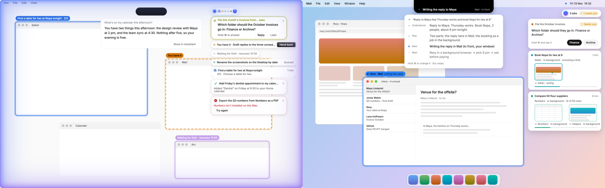
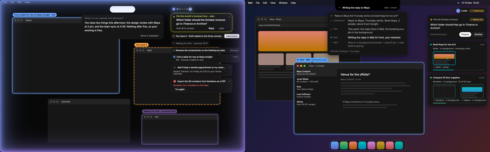

## Contents

1. [Inventory: every component today, and what's wrong](#1-inventory)
2. [One flow the person can always read](#2-one-flow)
3. [Visual language](#3-visual-language)
4. [Foreground and background, made visible](#4-foreground-and-background)
5. [The window recedes: answers and results projected on screen](#5-the-window-recedes)
6. [Proposed designs](#6-proposed-designs)
7. [Top 10 changes](#7-top-10-changes)
8. [Implementation plan for 4 parallel agents](#8-implementation-plan)
9. [How the images were made](#9-how-the-images-were-made)

---

## 1. Inventory

All current renders come from the existing headless tests
(`assistant_overlay::tests::snapshots`, `overview_tests::crowd_snapshots`),
over the story desk (`assistant_overlay::desk`, 1280 × 800). Full set in
`img/current-*.png`, light and dark where both exist.

### 1.1 The whole desk

| Light | Dark |
|---|---|
| 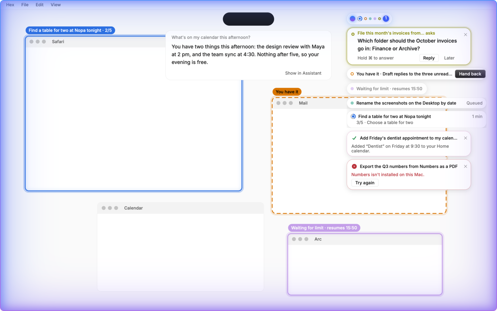 | 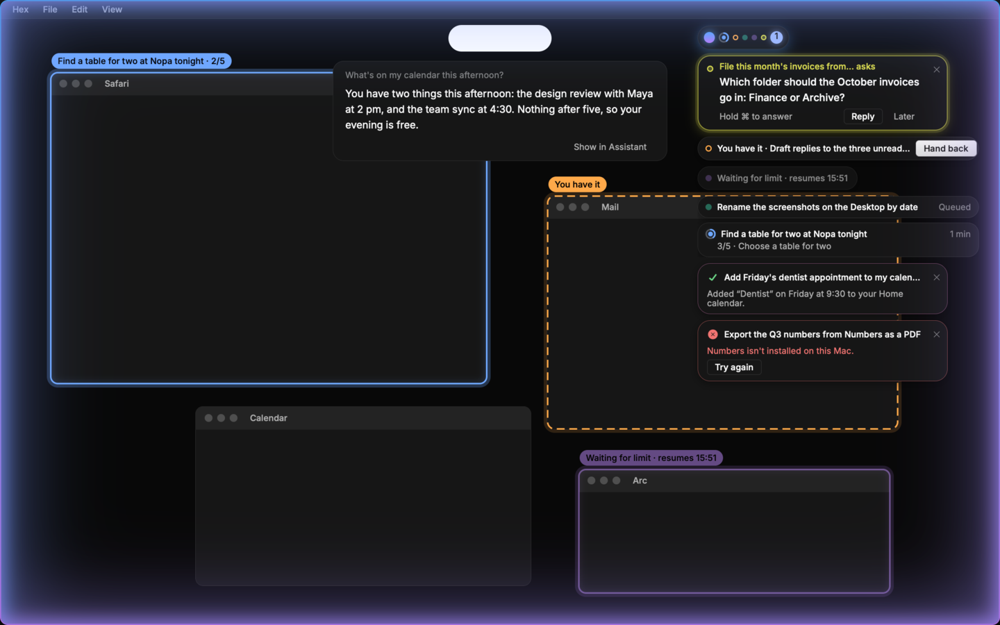 |

`current-desktop-*`: frame on, two outlined windows, Here bubble, orb with
question, held task, waiting task, queued and running rows, two results.

Problems:

- **P1 Overlap.** The orb's column (x ≈ 1090–1530) sits on top of the Mail
  window and its dashed outline; the Here bubble covers Safari's outline and
  its label's right end. Nothing in `place.rs` knows where windows or
  outlines are; it only knows the HUD and the display.
- **P2 Three anchors, no system.** HUD centre-top, the Here bubble under it,
  the orb to its right "past where the Here bubble hangs", the hint/Hands
  off/Listening pills between HUD and bubble. Each grows on its own; the eye
  has to search four places.
- **P3 The HUD flips colour.** `desk::draw` and the real HUD use
  `bg_inverse`: black in light mode, **white** in dark mode, while the notch
  next to it is always black. On a notch Mac the dark-mode HUD reads as a
  white blob beside a black notch.
- **P4 Outline labels lose the task.** "You have it" and "Waiting for limit ·
  resumes 15:50" replace the title, so the outline no longer says *which*
  task it is; the person must match colours with the orb.
- **P5 Colour carries meaning it can't hold.** The task palette
  (`assistant/palette.rs`: blue, orange, teal, magenta, olive, violet,
  **red**, brown) includes red (= failed elsewhere), orange (= "You have it"
  look), olive/yellow (= the inbox question, drawn in the asking task's
  colour), and blue/violet (= the assistant's own frame hues). A red task's
  dot next to a red ✗ result is ambiguous.
- **P6 The frame says less than it seems.** `view::frame_until` shows the
  whole-screen glow for 4 s (`ACTING_FOR`) after *any* desktop action of
  *any* live task, including one that clicks inside a parked, off-screen
  window. The person sees "the agent is on my screen" while nothing on
  their screen changes. It has no label at all.
- **P7 Reasoning is invisible.** Thinking is a spinner word ("Thinking…");
  steps are tool-ish ("Opened Calendar"). The person never sees what was
  understood or what will happen next until it happened.
- **P8 Density.** Nine floating things at once in the settled desk (frame,
  three outlines with labels, bubble, orb dots, question, two pills, three
  rows, two results). No limit across surfaces; each has its own (`MAX_ROWS`
  3, `MAX_POPS` 2, bubble steps 3).

### 1.2 Holding, listening, Here

| Hint "Here · Mail" while held | Listening after an answer |
|---|---|
|  | 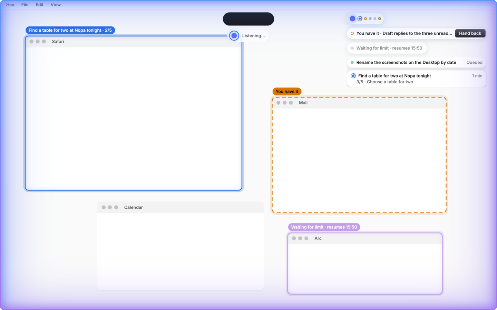 |

- **P9 No live words.** While the key is held the HUD shows dots only
  (`rune_hud` Dot scope); the words appear after release. The person can't
  see a mis-hearing until the answer is wrong.
- **P10 Listening overlaps the outline label** of the window under the HUD
  (`listening-layer` at `past`, no collision check), and "Listening…" fades
  after 1.8 s, leaving an unlabeled glowing dot.
- **P11 Here hint is tiny** ("Here · Mail", 11 pt) and the only place that
  says which app a quick turn will act in.

### 1.3 The Here bubble

| Thinking | Working | Streaming | Markdown | Asking | Failed | Setup |
|---|---|---|---|---|---|---|
| 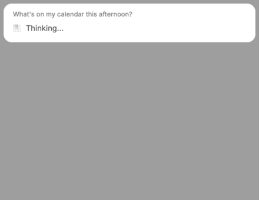 | 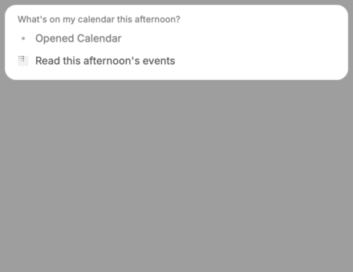 | 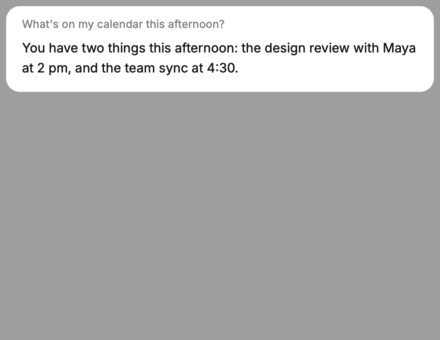 | 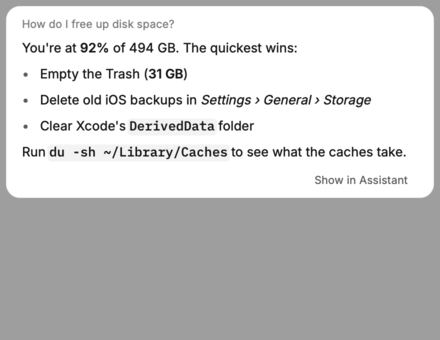 | 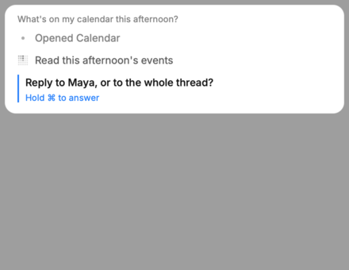 | 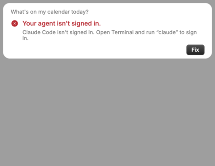 | 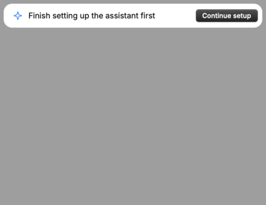 |

- **P12 Two bubble anatomies.** The Here bubble (440 wide, question in faint
  small text on top, no header, footer "Show in Assistant") and the orb's
  bubbles (`ask.rs`, `results.rs`: 320 wide, coloured title line, × top
  right, buttons left) disagree on width, header, where × is, where actions
  go, and the primary action's look.
- **P13 Steps use a dot-grid spinner** (`working`) beside a past step with a
  grey bullet: past and present look alike at a glance.
- **P14 "Show in Assistant" is the way out of every long answer**
  (`ANSWER_CHARS` 560 then "…"), which opens the window (§5).

### 1.4 Orb, rows, questions, results

| Orb with question | Results | Result unfolded | Recall list | Crowd: 6 jobs, helpers, desk |
|---|---|---|---|---|
| 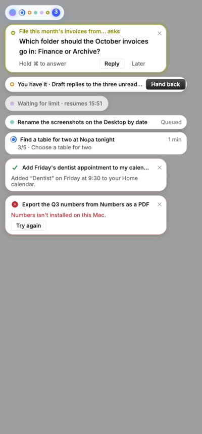 | 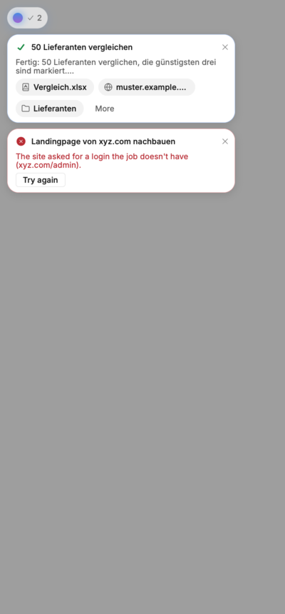 | 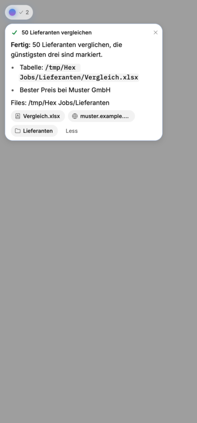 | 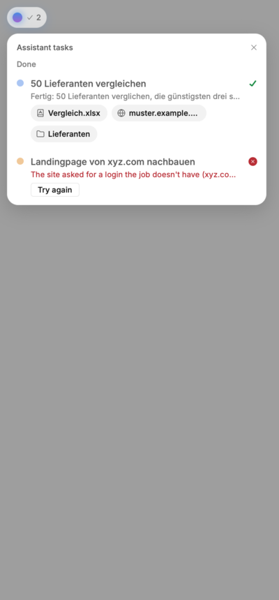 | 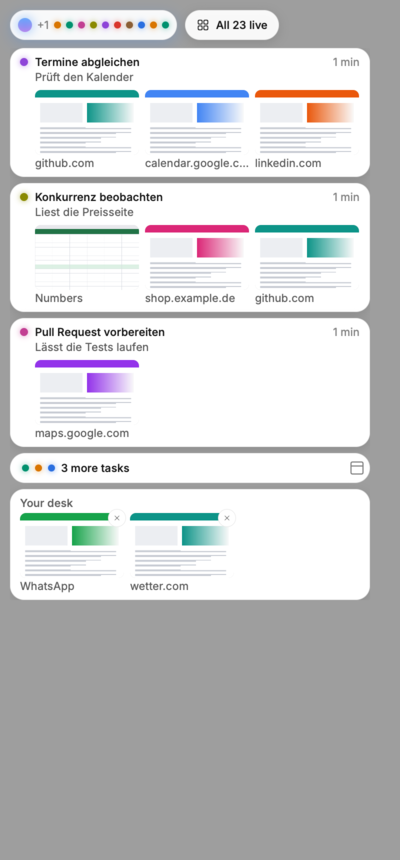 |

- **P15 Dots without words.** The orb's cluster is up to ten 6 pt dots with
  four encodings (full, ring, faint, progress ring). Unreadable at a glance
  and colour-only (fails WCAG 1.4.1).
- **P16 Thumbnail colour bars don't match the job.** In the crowd render the
  first job is violet, its thumbnails have teal, blue, and orange top bars
  (the bar is the page's own colour in the fixture, but reads as a task
  colour). A job's minis need the job's ring, not a random bar.
- **P17 No sign a picture is a parked window.** A mini doesn't say "in
  background" or "acting now"; the same picture is used for an idle browser
  and one being clicked.
- **P18 Question in the asking task's colour** (olive) with "… asks"
  truncated ("File this month's invoices from... asks"): the most important
  bubble has the least readable header.

### 1.5 The task list

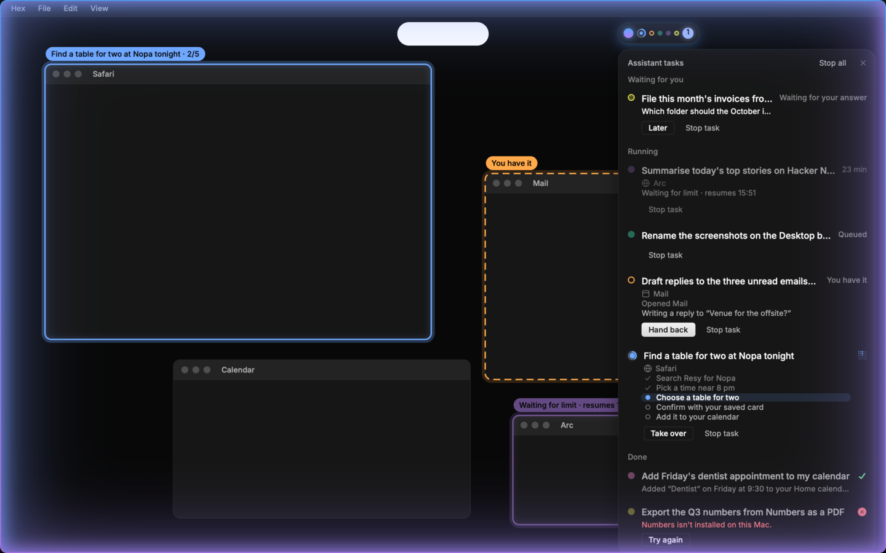

- **P19 It's a second, denser version of the rows** (372 wide) that covers
  the Mail outline completely, repeats "Stop task" under every row, and has
  its own vocabulary ("Waiting for your answer", "Queued", "You have it").

### 1.6 Hands off, hints, outlines

| Hands off on the desk | Hands off pill | Outline: you have it | Outline: waiting |
|---|---|---|---|
| 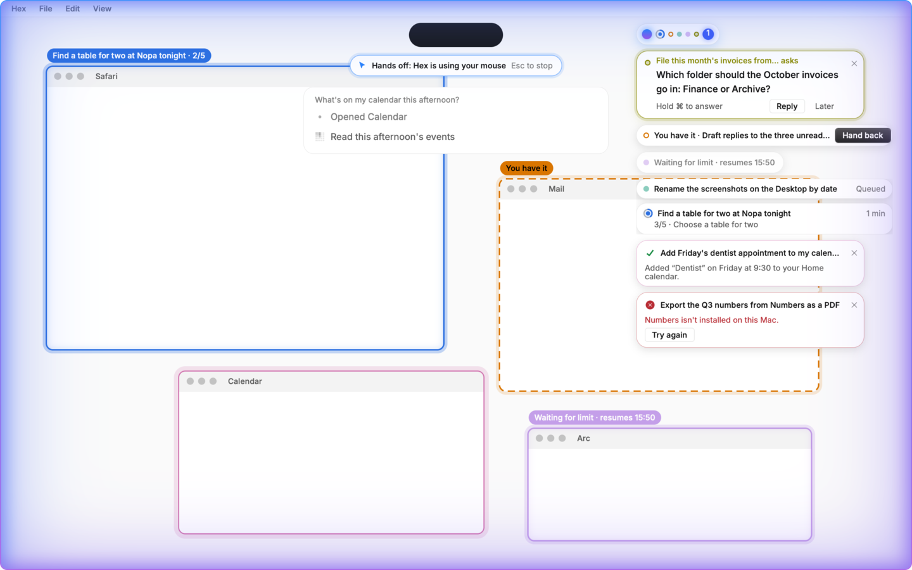 |  | 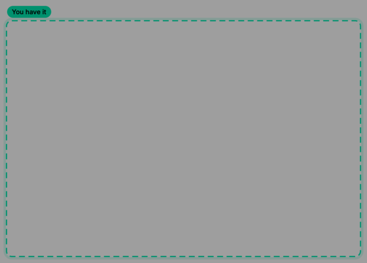 | 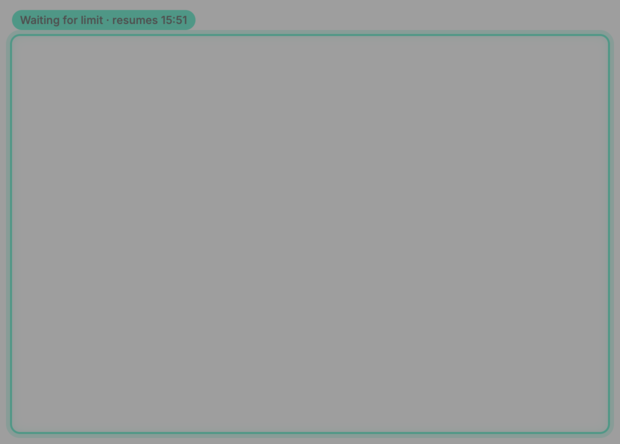 |

- **P20 Hands off is a pill, not a state of the screen.** "Hands off: Hex is
  using your mouse · Esc to stop" is the most consequential moment and gets
  the same pill as the Here hint; the Calendar outline it belongs to sits
  far away with a softer line and no label.

### 1.7 Wall, two displays, enlarged card

| Wall (everything) | Two displays |
|---|---|
| 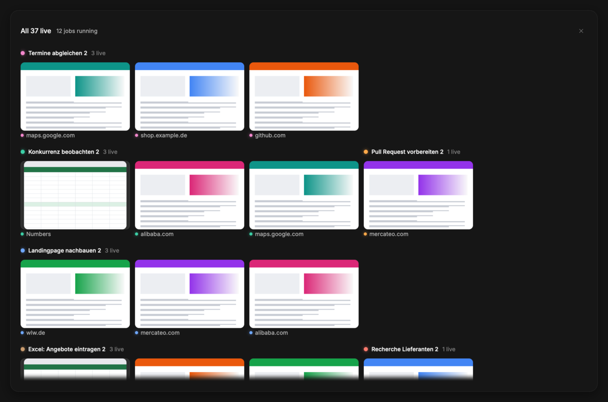 | 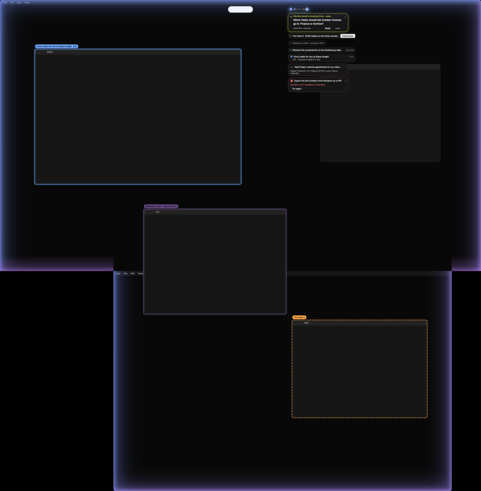 |

- **P21 "Show in Assistant" again** on the enlarged card (`live_card.rs:98`)
  and as the target of rows; the wall itself is good (grouped, captioned).
- **P22 The frame on two displays is right** (seams handled in
  `screens.rs`) and should be kept as is.

### 1.8 Missing states

No design today for: what was **understood** before acting; the moment an
app is **brought forward** for a background job (the guard's borrow in
`guard/proxy/borrow.rs` already does it, but emits no event, so no overlay
can say it); **control returned** ("Back to you"); a **queued** job's reason
(memory pressure, `capacity`); **undo** after a done action; a **pinned**
answer.

### 1.9 Wording

Today's copy mixes three voices: "Hex is using your mouse", "You have it",
"Waiting for limit · resumes 15:50", "… asks", "Show in Assistant". Proposed
rule: the state chip is always one of seven words (§2), the task title is
always the task's own short title, the app is always named, and the
assistant speaks in first person in bodies ("I'm bringing Numbers forward…")
but never in chips.

---

## 2. One flow

One state machine per request, the same words everywhere (island, rail,
outline chip, VoiceOver, spoken line, the Assistant pane).

```text
Idle ── hold ⌘ ──▶ Listening ── release ──▶ Thinking ──▶ Acting ──┬──▶ Done
  ▲                    │ Esc                    │ Esc      │  ▲     ├──▶ Failed
  │                    ▼                        ▼          ▼  │     └──▶ (job) Rail
  └──────────── Cancelled                  Cancelled     Asking
                                                                       ▼
                                          Recall (rail "Done", stage) ◀─┘
```

| State | Chip word | Island (top centre) | Card under island | Elsewhere | Motion | Sound / voice | Interrupt / take over |
|---|---|---|---|---|---|---|---|
| Idle | — | the notch only | — | rail head if jobs run ("2 jobs") | none | — | — |
| Listening | Listening | waveform in agent hue, "Listening…", elapsed time, "Mail in front" | **live words**, 17 pt, growing as recognised; "Release ⌘ to send · Esc to cancel" | nothing else changes | island grows from the notch (spring 0.35 s); words fade in per word | start tone (existing) | Esc cancels; release sends |
| Thinking | Thinking | ✦ + the **understood line** ("Understood: a table for two") | up to 4 reasoning lines: **Understood**, **Plan**, **Now**, **Next**, each one line, each ticked when passed | — | lines reveal top-down, 120 ms apart; no spinner | none (silent unless > 2 s, then "Mach ich" / "On it") | hold ⌘ to change it (steer), Esc stops |
| Acting (here) | Working | ✦ + what it does, "Mail · in front" | reasoning card shrinks to **Now** + **Next** after 4 s | window outline in agent hue with chip "Here · Mail · writing the reply" | outline draws on (0.25 s), then still | — | touching mouse/keys pauses ("You have it"), Esc stops |
| Acting (job) | Working | collapses back into the notch after 2 s; the job's row appears in the rail | — | rail row: dot, title, "Safari · in background · choosing a time", minis with ring, plan bar | the card flies to the rail (existing `fly`) | one short line ("Läuft im Hintergrund") | rail row → Take over / Stop |
| Brought forward | In front | **desk frame + tab**: "Agent-Desk is using Numbers for a moment · Esc to stop · back in 2 s" | why card beside the window: reason, what happens after, "Let me do it" | outline on that window in the task's colour | frame fades in 0.3 s, no breathing while in front | soft tick at start and end | any input pauses and hands it over; Esc stops; "Let me do it" = take over |
| Asking | Needs you | "? Book Nopa needs you" | question card: task dot + title, chip, question ≤ 3 lines, answer buttons (≤ 1 primary), "Hold ⌘ and say it" | rail head badge "1 needs you" | card slides from the rail or island, one gentle bounce | question read aloud when nothing else speaks (existing inbox rules) | hold ⌘ answers; Later defers; × hides (still waits) |
| Done | Done | ✓ + result in a phrase ("Booked · Nopa 8:15 pm") | short result card (≤ 4 lines) with the result's own action ("Open in Calendar") + Undo when reversible; longer → **stage** (§5) | rail row turns into a result row for 20 min | ✓ draws, card stays 12 s (existing `DONE`), longer while read aloud | success sound; summary read aloud | Esc puts it away; pin keeps it |
| Failed | Failed | ✗ + "Couldn't book Nopa" | why in one line in the person's language, the brain's words small under it, **one** fix (Fix / Sign in… / Try again) | rail result row with ✗ | no shake; ✗ draws | error sound; the line is spoken | Try again re-asks in the same conversation |
| Recall | Done | — | — | rail "Done" group; a press re-projects the result on the stage | — | — | "what did you just do?" reads the last result |

Rules that hold in every state:

- **One sentence per surface.** The island line is ≤ 48 characters, a card
  body ≤ 4 lines; more goes to the stage.
- **The reasoning lines are summaries the agent writes for the person**, not
  model chain-of-thought: `Understood` restates the request with the
  resolved details (who, what, when), `Plan` names the lanes and apps,
  `Now`/`Next` come from the plan's steps (`view::Task.plan`). Max 80
  characters each.
- **Esc always does the same thing**: stops what the island shows (or puts
  away the card when it's over). ⌃⌥Esc stops everything (unchanged).
- **Touching the mouse or keyboard while the agent has the controls is
  always "take over"**, never a fight: it pauses the task and shows
  "You have it · Hand back" (existing `Paused` look).

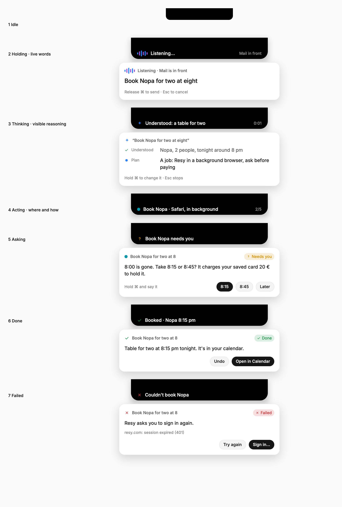

---

## 3. Visual language

### 3.1 Three places, fixed

| Place | Where | What lives there | Never |
|---|---|---|---|
| **Island** | grows from the notch (or, without a notch, from a 196 × 34 black capsule under the menu bar centre, where the HUD is today) | the current conversation: listening, live words, thinking, here-acting, the control tab, the short answer | jobs, lists |
| **Rail** | top right, 18 pt from the edge, under the menu bar (where macOS puts notifications); draggable as the orb is today, remembered per display | the orb head ("3 jobs · 1 needs you"), the question card, job rows with minis, results, the task list unfolds here | the Here conversation |
| **Stage** | under the island, centred, 560–640 wide, up to 70 % of the display's height | long answers, results with files/folders/links/sheets, the live picture large, the wall | anything that isn't the person's deliberate focus right now |

The island is **always black** in both appearances: it is the notch. Cards
under it and in the rail use the kit's `bg_base` material (light or dark).
This fixes P3 and gives the eye one anchor (P2).

Collision rules (`place.rs` gets the window rects the watcher already has):

1. A card never covers the **focus window's title bar or the text caret**;
   if the island card would, it moves to the side of the focus window with
   the most room (the "why" card in the foreground image does this).
2. The rail never covers an **outlined** window: when one is under it, the
   rail flips to the left edge of that display.
3. Outline chips sit above the window's top-left; if that hits the menu bar,
   inside the top-left (today: bottom-left, which is far from the title).
4. Nothing is placed over the Dock or the menu bar except the island.

### 3.2 Colour

- **Agent hue** (today's frame periwinkle → violet, `palette::frame`): only
  for the assistant itself: the island's glyphs, the desk frame, the Here
  outline, listening.
- **Task colours**, proposed six: azure 205°, amber 60°, teal 170°, rose
  340°, lime 95°, clay 25° (oklch L 0.60 light / 0.76 dark), chosen to stay
  ≥ 0.1 ΔE from each other *and* from the semantic colours and the agent
  hue. Red, green, violet and blue leave the task palette (P5). Today's
  `every_colour_stands_apart_from_every_other_and_wraps` test gets the
  semantic colours added to its set.
- **Semantic**: done green 150°, failed red 25°, needs-you amber 80°. Always
  paired with a glyph (✓ ✗ ?) and a word (§2), never colour alone (WCAG
  1.4.1).

### 3.3 Type

Four sizes only (all from the kit's Inter, `TextStyle { size, .. }`):
title 17/22 medium (live words, result headline), body 14/20, label 12/16
medium (card headers, buttons, chips), meta 11.5/15 (hints, places, times).
The island line is 13.5 medium white.

### 3.4 One bubble anatomy

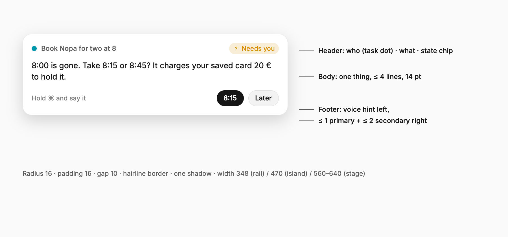

```text
┌─────────────────────────────────────────────────┐
│ ● Task title (or ✦ the words you said)  [chip] │  header: who · what · state
│ Body: one thing, ≤ 4 lines, 14 pt               │
│ ✓ Understood  …                                 │  optional reasoning lines
│ Hold ⌘ and say it            [Second] [Primary] │  footer: voice hint left, actions right
└─────────────────────────────────────────────────┘
radius 16 · padding 16 · gap 10 · hairline · one shadow (28/10, 16 % light, 45 % dark)
widths: 348 rail · 470 island · 560–640 stage
```

- At most one primary (inverse fill) and two secondary actions; × and pin
  live in the header's right end only on the stage.
- The voice hint is always there when the action can be said.
- This replaces `bubble::card`, `ask::bubble`, `results::bubble`, the
  `stack` rows' action strip and `hands::pill` (§8, agent A).

### 3.5 Frames: three tiers, one meaning each

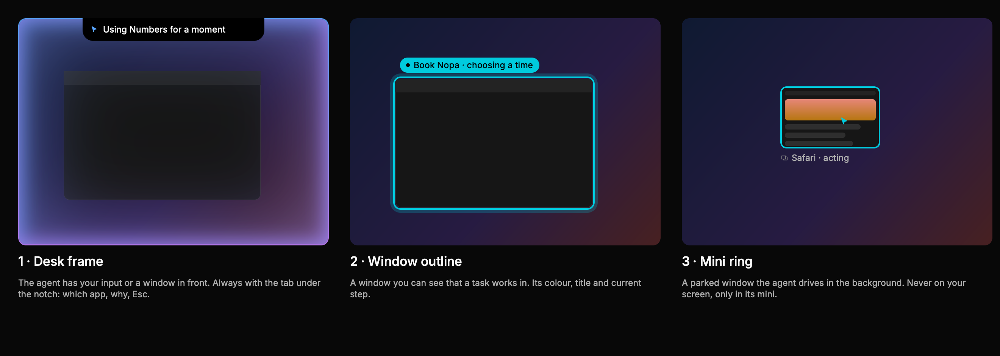

| Tier | Looks | Appears exactly when | Means | Never |
|---|---|---|---|---|
| 1 **Desk frame** | today's two-hue glow (`frame::glow`), still (no breathing while in front), plus the black **tab** hanging from the island naming the app, why, Esc, and a countdown | the agent uses the person's real pointer/keys (`hands_off`) **or** has brought a window to the front (borrow) | "don't touch, the agent has the controls; here's how to stop it" | for work inside parked windows, browsers, files |
| 2 **Window outline** | 2 pt solid line in the task's colour (agent hue for Here) + 5 pt soft ring, chip above top-left: dot · title · current step (· 2/5) | a live task works in a window **the person can see** (Here lane's front window; a job's window while borrowed) | "this window is being worked in" | for parked/off-screen windows; dashed = you have it; 50 % = waiting, chip keeps the title + "resumes 15:50" |
| 3 **Mini ring** | ring around the mini in the rail: solid + glow + small pointer = acting now; thin = parked, idle; dashed = you have it | a job drives a parked window (`assistant::space`, `app_live`) | "the agent is working in this window, away from your screen" | on the screen itself |

`view::frame_until` changes from "any desktop action in the last 4 s" to
"`hands_off` or a borrow is active" (P6).

### 3.6 Density limits

| Surface | Max at once | Overflow |
|---|---|---|
| Island | 1 line + 1 card | newer replaces older; older goes to the rail/stage |
| Rail | head + 1 question + 3 job rows + 1 result | "N more" line opens the list in place |
| Minis per row | 2 in view, the rest in a sideways filmstrip | "All N live" (press or rest the pointer) opens the live overview in the rail; its "Large" opens the wall |
| Outlines | one per visible window | second task in the same window: chip says "2 tasks" |
| Stage | 1 panel | pinned panels shrink to a chip in the rail |
| Desk frame | 1 | — |

Total floating cards on screen (island card + rail cards + stage): ≤ 5.

### 3.7 Light, dark, accessibility

- Every render check exists in light and dark (as today's snapshot tests).
- Contrast: card text ≥ 4.5:1 on `bg_base`; chips' words ≥ 4.5:1 on their
  12–16 % tint (add to `palette` tests); outline chip ink via `palette::ink`
  (≥ 3:1 today, raise to 4.5:1).
- **Reduce motion**: no breathing (frame, orb), no flying card (fade only),
  reasoning lines appear at once, waveform becomes a static level bar.
- **VoiceOver**: island is a live region (polite) reading "Listening",
  then the live words on release, "Thinking: understood …", etc.; questions
  are assertive; every chip has its word as label; minis are labelled
  "Safari, Book Nopa, in background, acting"; the desk frame announces
  "Agent-Desk is using Numbers. Escape to stop." once.
- Never colour alone: every state has glyph + word; task dots carry the
  title next to them.

---

## 4. Foreground and background

Policy (unchanged in spirit, the guard already prefers background:
`BACKGROUND_FIRST` in `guard/proxy/borrow.rs`):

1. A job's windows are **parked** and driven in the background
   (AX, events, scripting). They show only as **minis with a ring** in the
   rail. Nothing on the person's screen changes; no frame.
2. Only when an app refuses background work (a sheet or dialog that needs
   keys, a captcha, `desktop_focus_window` called a second time) does the
   guard **borrow the front**. Then, in this order:
   - the island says it one beat before (≥ 400 ms): "Agent-Desk is using
     Numbers for a moment";
   - the **desk frame** fades in, the window gets its **outline** in the
     task's colour with the step ("exporting PDF");
   - a **why card** sits beside the window: the reason in one sentence,
     what happens after ("Numbers goes back to the background, Mail is in
     front again"), and **Let me do it**;
   - the tab counts down the expected time ("back in 2 s") from the guard's
     borrow budget.
3. **Control returns**: the window is parked again, the person's previous
   front window and caret are restored (the borrow already records
   `before`), the frame fades out, the island shows "Back to you · Mail" for
   1.5 s.
4. **Interrupting**: any person input during a borrow pauses the task and
   hands the window over ("You have it", dashed outline, Hand back in the
   rail). Esc stops the task. Neither ever leaves the window off-screen.

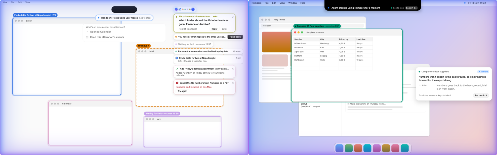
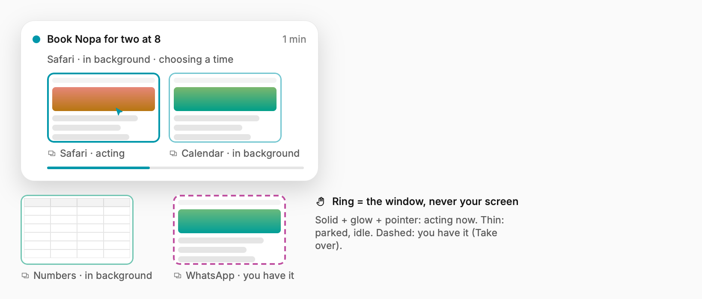

Needed in the brain: `Event::Borrowed { conversation, window, app, why,
until_ms }` and `Event::Returned { conversation, to }` from the guard's
borrow (today it emits nothing the overlay can read), and `view::Task`
keeping `borrowed: Option<Borrow>`.

---

## 5. The window recedes

Requirement (person, top priority): *Answers, results, folders to open and
everything are projected on the screen; the desktop app should pop up much
less.* The overlay is the primary surface for answers (long and Markdown
included), results with files/folders/links/sheets, plans and progress,
questions, failures with Fix/Try again, and mid-task controls (take over,
hand back, stop). The Assistant pane stays as the history and settings.

### 5.1 Every place that opens or raises the window today

| # | Trigger | Code | Today | Proposal |
|---|---|---|---|---|
| W1 | Here bubble "Show in Assistant" (every long answer, `ANSWER_CHARS` 560) | `bubble.rs:315` → `host::open_chats` → `window_link::open_chat` / `macos_rune::open_chat` → `bring_window_forward` | opens the pane on the conversation, app activates | **Replace**: "More" expands the answer onto the **stage** (scroll, copy, save as note, pin). "Open in Agent-Desk" moves to the stage's overflow menu (deliberate) |
| W2 | Enlarged live card "Show in Assistant" | `live_card.rs:98`, `host/enlarged.rs` | opens the pane | **Replace**: the card has "What it did" (steps on the stage); window only from overflow |
| W3 | Orb rows / task list pressing a task | `stack.rs`, `orb::Actions` → `set_open_chats` | opens the pane on that job | **Replace**: a press unfolds the row (plan, steps, minis) in the rail; results re-project on the stage |
| W4 | Notification click (job done/failed while away) | `assistant::notify::set_open` → `open_chat` (`window_link.rs:83`, `macos_rune.rs`) | opens the pane | **Replace**: clicking shows the result on the stage on the display the pointer is on; notification's own "Open Agent-Desk" action = deliberate |
| W5 | Hold of the Action shortcut before setup is done | `recognition::ask::set_open_setup` / `assistant::shortcut::open_setup` → `setup_needed()` **and** `open_assistant_setup()` (`macos_rune.rs:519`, `window_link.rs:79`) | says "Finish setting up" **and** opens the onboarding window automatically | **Replace**: island card "Finish setting up · 2 steps left: Microphone, Agent" with **Continue setup** (deliberate click opens the guide); permissions that can be asked in place (microphone, accessibility prompts) are asked from the card |
| W6 | "Continue setup" on the setup bubble | `bubble::setup_card` → `open_setup` | opens onboarding | **Keep** (deliberate click) |
| W7 | Failure "Fix" | `host.rs:281/285` → `open_setup` / `window_link::open_assistant_settings` | opens setup repair page or Assistant settings | **Mostly replace**: assistant off → an inline "Turn on" in the card; not signed in → "Sign in…" runs the backend's login (Terminal or browser) from the card; usage limit → "Wait / switch model" in the card; only missing permissions keep opening System Settings (not the Hex window) |
| W8 | Repair check every 5 min | `chats/setup/repair.rs::received` → `open` (`CHECK_EVERY`) | silently switches the window's content to the repair flow (shows next time the window is opened; at launch with the window open it takes it over) | **Replace**: a rail card "Agent-Desk needs Accessibility again" with **Fix** (opens just that System Settings pane) and Later; the window guide only from **Fix all…** |
| W9 | Launch while setup/onboarding unfinished, or settings error | `macos_rune::launch` `LaunchWindow::decide` | opens the window | **Keep** for first run and the settings error (nothing else can explain them); after first run, never |
| W10 | Reopen (Dock icon click), menu bar "Assistant…", "Settings…", `hex window show`, `hex-dev://` / `hex://` links, check for updates | `MenuTarget::handle_reopen`, `status_item.rs:168`, `control.rs:514`, `rune_ui.rs:223/236`, `show_update_check` | opens the window | **Keep** (explicit asks). Rename the menu item to "Open Agent-Desk" |
| W11 | "Take over" on a parked app window | `app_live`, `enlarged` | brings **that app's** window to the person (not Hex's) | **Keep**, with the §4 hand-over look |

Rule after this: **the Agent-Desk window opens only on an explicit request
by the person** (menu bar, Dock, CLI, a link, an "Open in Agent-Desk" item,
first run). A test enforces it: every caller of `window_link::open_*` and
`bring_window_forward` is in an allow-list of explicit entry points
(`code_shape_tests.rs` style).

### 5.2 Long answer on the stage

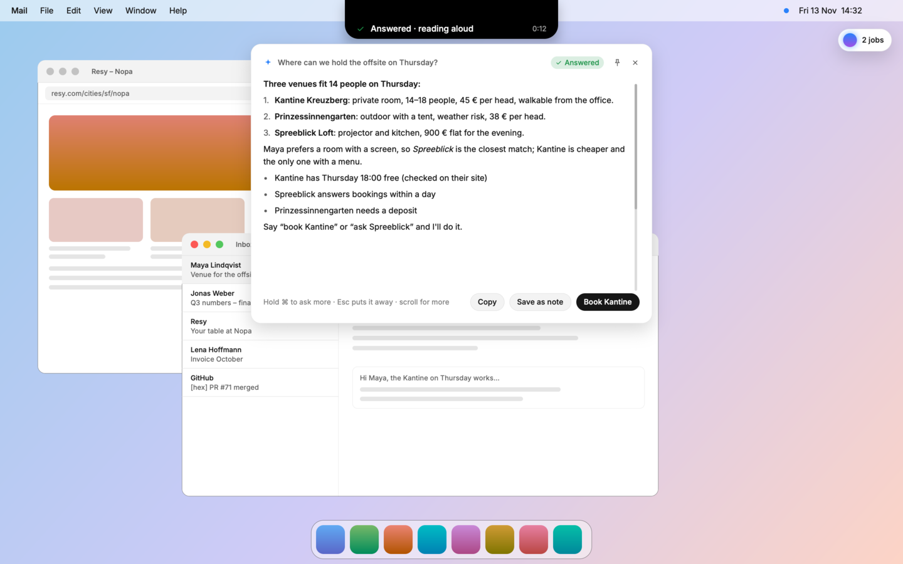

- Projects under the island, 640 wide, Markdown (`markdown::view`), up to
  70 % of the display tall, **scrolls** with the wheel and ↑↓ / Space.
- Header: the question as asked, chip "Answered", **pin** and ×.
- Footer: "Hold ⌘ to ask more · Esc puts it away", Copy, Save as note, and
  the answer's own next action as primary ("Book Kantine").
- Stays while read aloud and while the pointer is on it; else folds after
  20 s into the rail's Done group (recall). **Pinned**: stays, shrinks to a
  chip in the rail when another stage panel opens; a press brings it back.
- Takes the keyboard only while the pointer is on it or it was opened by a
  press (as the enlarged card does).

### 5.3 Results panel

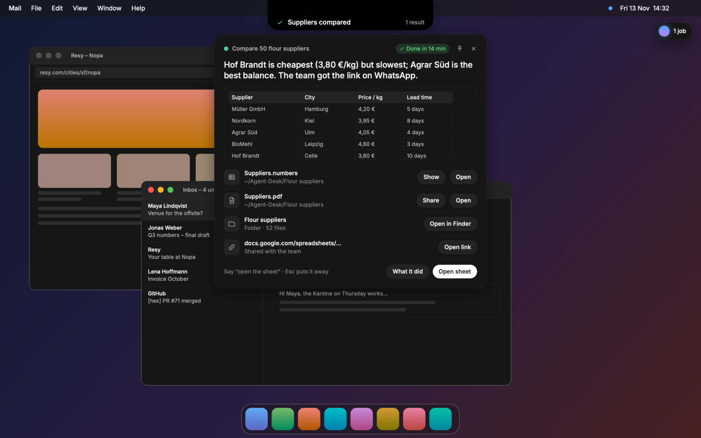

- Headline: the result in one sentence (title size), then a **preview**
  (sheet's first rows, image, PDF page, the page's screenshot), then the
  named targets (today's `results::targets`: links, paths, the runner's
  "Files: <folder>") as rows with their own verbs: Open, Show (in Finder),
  Share, Open in Finder, Open link; max 4, "N more" expands.
- Footer: "What it did" (the steps and the audit file on the stage, never
  the window), the primary action for the main artifact ("Open sheet").
- Voice: "open the sheet", "show the folder", "share it with Jonas" act on
  the panel's targets.

---

## 6. Proposed designs

All are real Rune renders with the kit tokens (prototype in §9), on a
1440 × 900 desk with a notch, a menu bar, a Dock, and believable windows.

| | Light | Dark |
|---|---|---|
| Overview: thinking + here outline + rail with question, minis | 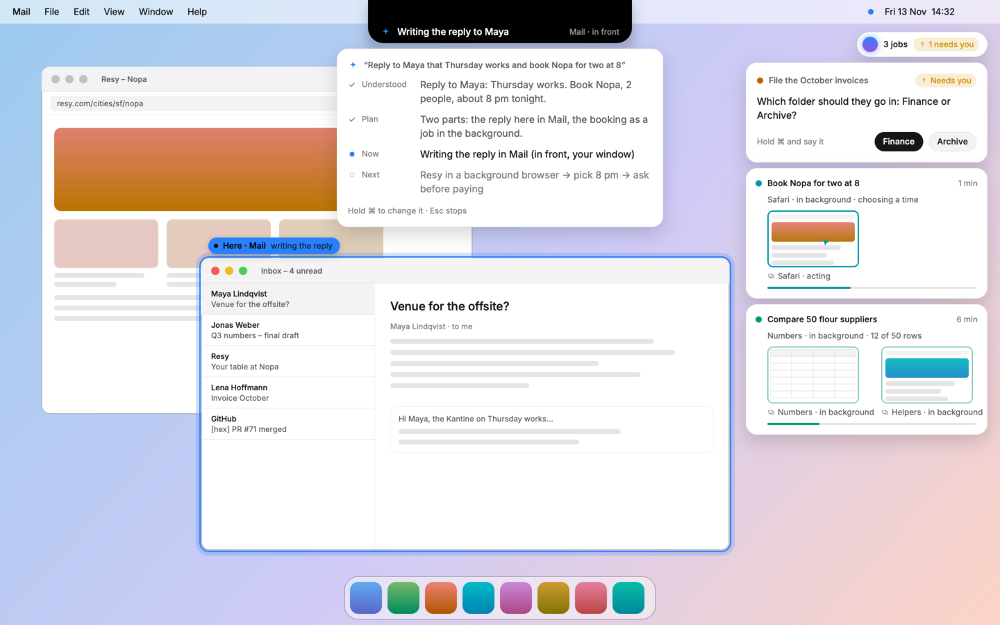 | 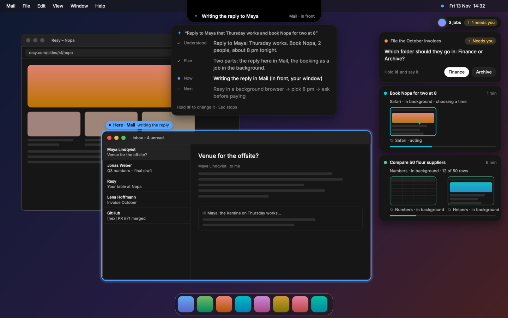 |
| Listening with live words | 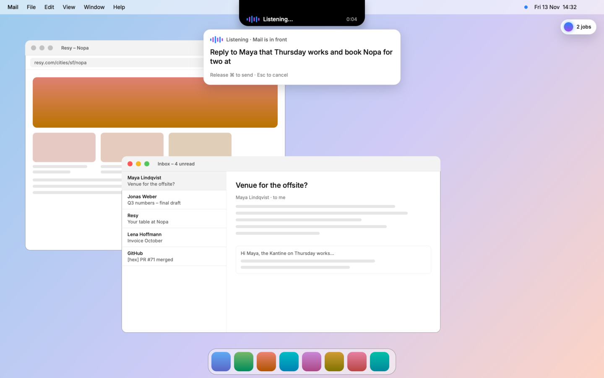 | 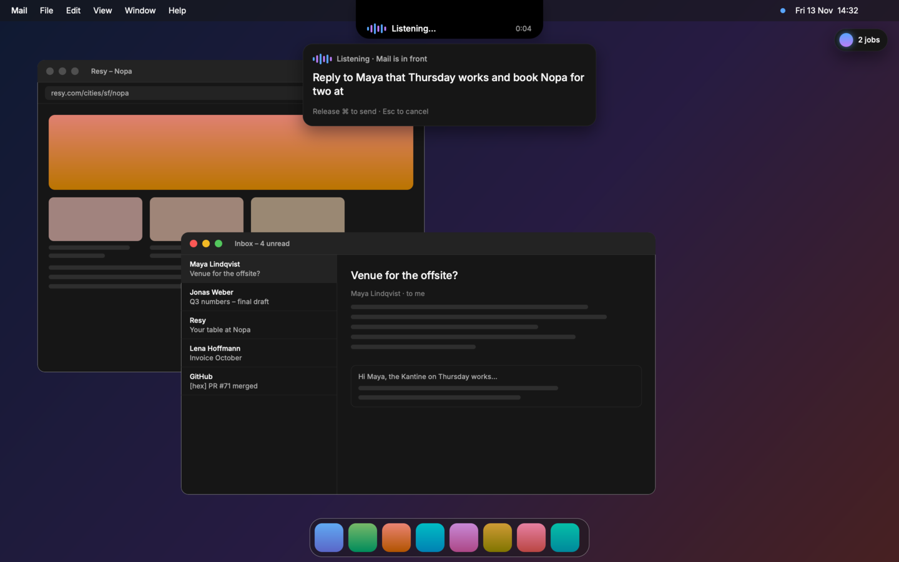 |
| Brought forward for a moment | 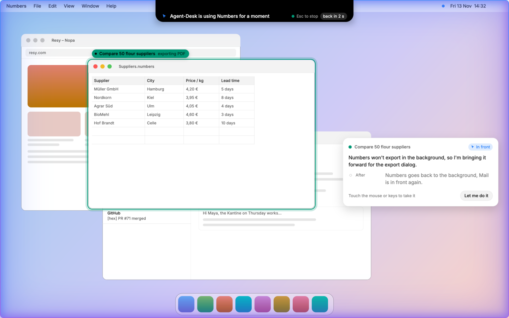 | 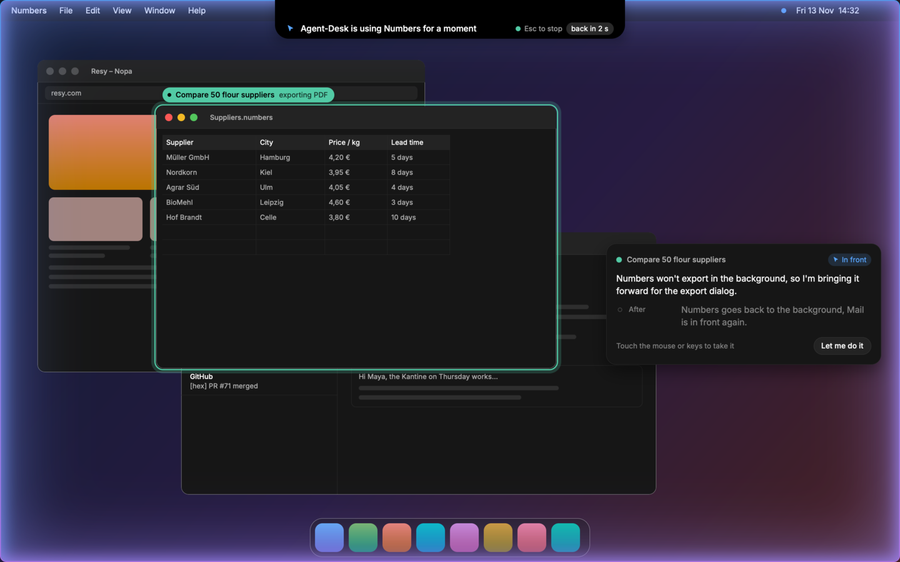 |
| Long answer on the stage |  | 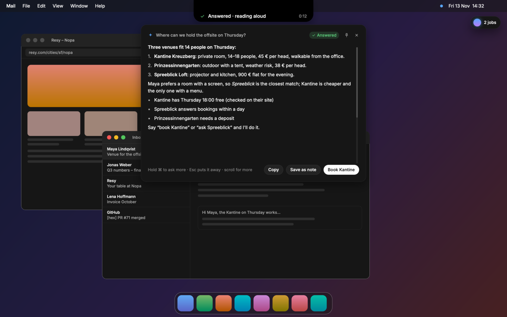 |
| Results panel | 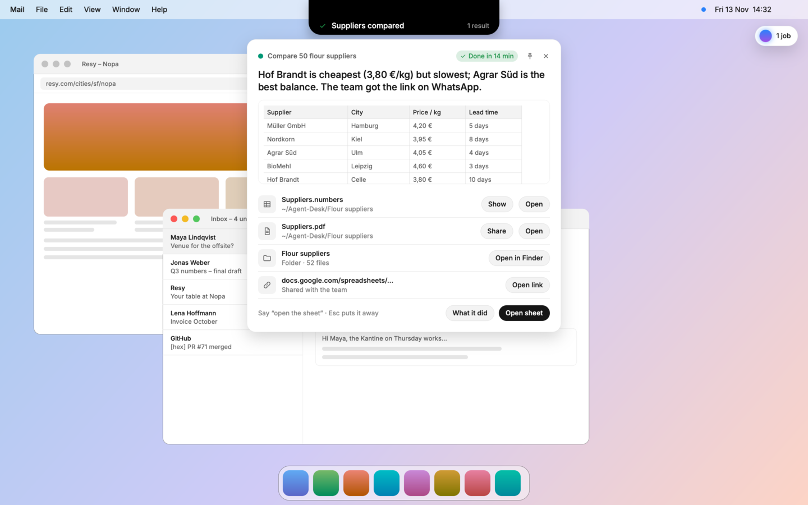 |  |
| Island states |  | 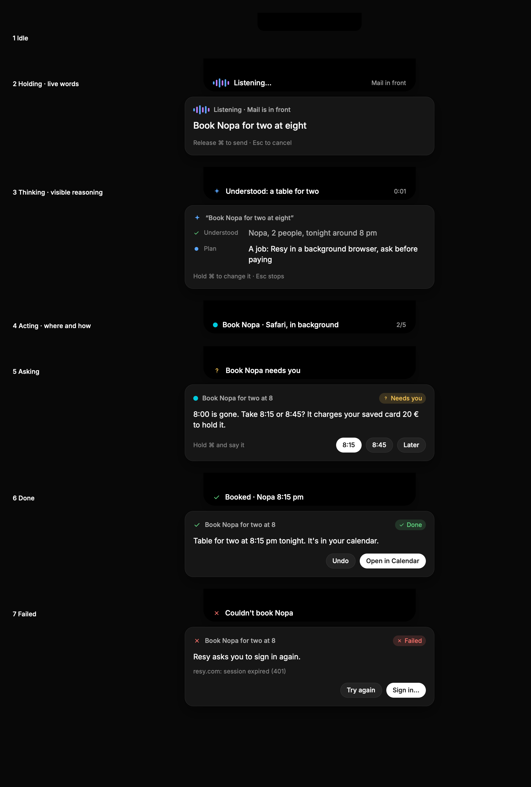 |
| Frame tiers | 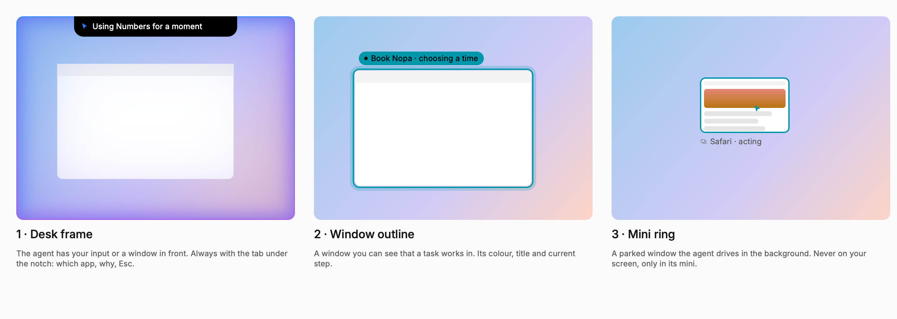 |  |
| Minis and rings |  | 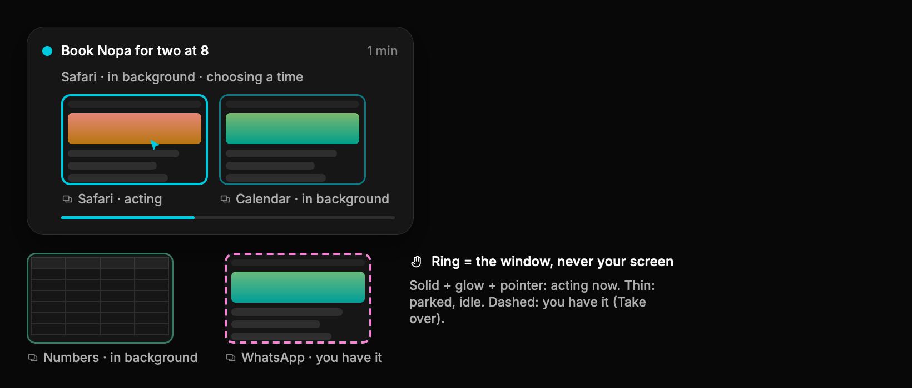 |

Side by side with today:

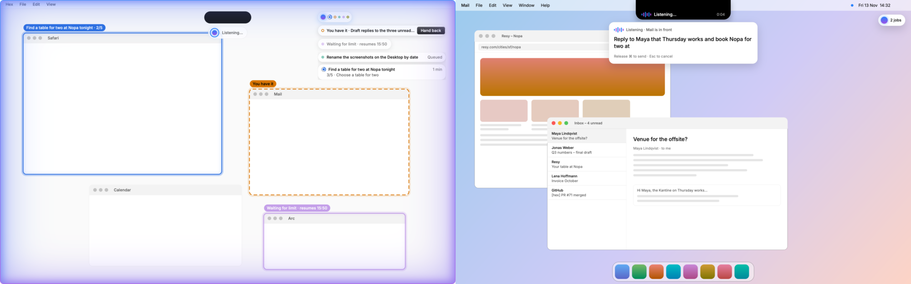
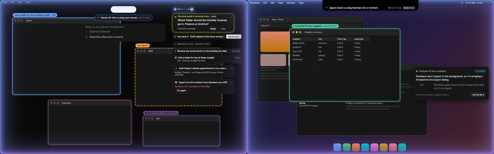

Known gaps of the mockups: the orb's breathing, the waveform's motion, and
the reasoning lines' reveal are static; the island is drawn at the notch of
a 14″ MacBook Pro only (the Studio Display variant is the same capsule under
the menu bar).

---

## 7. Top 10 changes

1. **Three places**: island (conversation) at the notch, rail (jobs) top
   right, stage (big answers, results, live pictures) under the island.
   Replaces HUD-side orb, Here bubble, hint, listening and Hands off pills.
2. **The island is always black** and grows from the notch; it carries the
   one-line state in every phase (fixes the white dark-mode HUD).
3. **Visible reasoning**: Understood · Plan · Now · Next, four short lines
   the agent writes for the person, ticked as they pass; no spinner words.
4. **Live words while holding** ⌘, so a mis-hearing is seen before release.
5. **Three frame tiers with one meaning each**: desk frame only when the
   agent has the person's input or a window in front (always with the tab:
   app, why, Esc, countdown); window outline only for visible windows; mini
   ring for parked ones. `frame_until` stops lighting the screen for
   background clicks.
6. **Foreground moments are announced and returned**: "Agent-Desk is using
   Numbers for a moment", why card, "Back to you · Mail", focus restored;
   any touch = take over. Needs `Event::Borrowed/Returned`.
7. **One bubble anatomy** (header: who · what · chip; body ≤ 4 lines;
   footer: voice hint + ≤ 1 primary + ≤ 2 secondary) for Here, questions,
   results, failures, setup.
8. **Colour discipline**: six task hues clear of red/green/amber/agent hue;
   semantic states always glyph + word; outline chips keep the task title in
   every look.
9. **The window recedes**: "Show in Assistant", notification clicks, holds
   before setup, the 5-minute repair and most Fix buttons stop opening the
   window; long answers and results project on the stage (scroll, pin,
   copy, open targets). The window opens only on explicit request, guarded
   by a test.
10. **Placement and density rules**: nothing covers the focus window's
    title bar/caret or an outlined window; ≤ 5 floating cards; fixed caps
    per surface with "N more".

---

## 8. Implementation plan

After the rename lands. Four agents, disjoint file ownership, in this
order of merge: **A** first (tokens other agents import), then B, C, D in
parallel. Each agent renders its components in light and dark with the
existing ignored snapshot tests (extend `assistant_overlay::tests::snapshots`
with the names below) and attaches the PNGs to its PR. Filtered tests only
(`cargo test --bin hex assistant_overlay`), never audio tests, never the full
suite (CLAUDE.md).

### Agent A: tokens, anatomy, rail

Files: `assistant_overlay/palette.rs`, `assistant/palette.rs`, new
`assistant_overlay/look.rs` (type ramp, material, chip, pill button, card
anatomy, glyphs), `bubble.rs` (anatomy only, not placement), `ask.rs`,
`results.rs`, `pops.rs`, `jobs.rs`, `stack.rs`, `orb.rs`, `orb/*`,
`place.rs` (rail default top right, flip rule), `minis.rs`,
`desktop/i18n/assistant_overlay.rs` (new chip words in five languages).

Tasks:

1. `look.rs` with `card(Card { lead, title, chip, body, hint, actions, width })`,
   `chip(state)`, `button(kind)`, the four `TextStyle`s; port `ask`,
   `results`, `bubble`, `stack` rows to it.
2. New task palette (six hues) and semantic colours; extend the palette
   tests with semantic and agent hues; `ink` to 4.5:1.
3. Rail: orb head with count + "N needs you" chip (replaces the dot
   cluster), question card on top, job rows with "App · in background ·
   step", plan bar, ≤ 3 rows + "N more".
4. `place.rs`: default anchor top right under the menu bar; flips left when
   an outlined window is under it (input: outline rects from the watcher).

Acceptance (render + unit):

- `assistant-rail-*`, `assistant-question-*`, `assistant-result-*`,
  `assistant-list-*` (light/dark) match §3.4's anatomy: one header row, ≤ 1
  primary, voice hint left.
- `every_task_colour_stands_apart_from_semantic_and_agent_hues` (ΔE ≥ 0.1),
  `chip_words_have_4_5_contrast`, `every_state_has_a_glyph_and_a_word`.
- `rail_never_covers_an_outlined_window` (place unit test),
  `rail_shows_at_most_three_rows_and_one_question`.

### Agent B: island, voice states, reasoning

Files: `rune_hud.rs` + `rune_hud/hud_placement.rs` (island colour: always
black; growth below the notch), `assistant_overlay/hint.rs`,
`listening.rs`, `hands.rs` (folded into the island), `quick.rs` (bubble
state gets `understood`, `plan`, `now`, `next`), `host/answer.rs`, the
island card placement in `bubble.rs`'s view (not its anatomy), and on the
brain side `assistant/view.rs` + `assistant/view/task.rs` (new fields),
`assistant/types.rs` (`Event::Understood { conversation, text }`),
`assistant/tools.rs` (a `hex_status` tool or the Here prompt's first line
as `Understood`), `assistant/lines.rs`.

Tasks:

1. Island: one black capsule from the notch with the state line; the HUD's
   Dot scope stays inside it while held.
2. Live words: feed the partial transcript (the dictation pipeline's live
   text, `rune_ui/live_text`) into the island card while held.
3. Reasoning: `Understood` from the agent (one line, ≤ 80 chars, in the
   request's language), `Plan/Now/Next` from `Task.plan`; ticks as steps
   pass; collapse to Now + Next after 4 s.
4. Thinking voice line only after 2 s silent ("Mach ich" / "On it").

Acceptance:

- `assistant-island-{idle,listening,thinking,acting,asking,done,failed}-*`
  renders; the island is black in both themes (pixel check at its centre).
- `the_understood_line_is_shown_before_the_first_step` (fixture events),
  `reasoning_shows_at_most_four_lines`, `live_words_update_while_held`
  (reducer test on `quick.rs`), VoiceOver live-region labels present
  (`role("status")` / `live_region` on the island).
- Reduce motion: `still` renders identical to motion-off renders.

### Agent C: frames, outlines, foreground policy, minis' rings

Files: `assistant_overlay/frame.rs`, `outline.rs`, `cursor.rs`,
`screens.rs`, `host/watcher.rs`, `host/follow.rs`, `app_live.rs` and
`pictures.rs` (the ring around a mini, drawn by a `ring(look)` helper the
rail's thumbnails call), `assistant/view.rs::frame_until`,
`assistant/guard/proxy/borrow.rs` (emit the events),
`assistant/types.rs` (`Event::Borrowed`, `Event::Returned`; coordinate the
enum edit with B by landing C's variants in one small first commit).

Tasks:

1. `frame_until`: only `hands_off` or an active borrow; no frame for
   background clicks.
2. Control tab under the island: app, why (from the borrow's reason), Esc,
   countdown from the borrow budget; frame still (no breathing) meanwhile.
3. Outline chip: dot · title · step (· n/m) in every look; dashed/dim
   looks keep the title; label inside top-left when no room above.
4. Mini rings: acting (solid + glow + pointer), idle (thin), yours (dashed);
   caption "App · in background/acting/you have it".
5. Return: restore `before`, island "Back to you · App" 1.5 s.

Acceptance:

- `assistant-frame-borrowed-*`, `assistant-outline-{working,paused,waiting,hands-off}-*`
  (every one shows the task title), `assistant-mini-{acting,idle,yours}-*`,
  `assistant-two-displays-*` unchanged around the seam.
- `no_frame_for_work_in_parked_windows`, `a_borrow_shows_the_frame_and_its_tab_until_returned`,
  `returning_restores_the_person's_front_window` (guard tests with the fake
  desktop), `outline_label_names_the_task_in_every_look`.

### Agent D: the stage, and the window recedes

Files: new `assistant_overlay/stage.rs` (+ `host/stage.rs`), `results.rs`'s
`targets` (read only; A owns drawing), `enlarged.rs`, `live_card.rs`,
`wall.rs` (shown on the stage), `host.rs` (`open_chats` → stage),
`rune_ui/window_link.rs`, `macos_rune.rs` wiring (`set_open_chats`,
`set_open_setup`, `ask::set_open_setup`), `assistant/notify.rs` (click →
stage), `assistant/shortcut.rs::open_setup`, `rune_ui/chats/setup/repair.rs`
(no silent takeover; a rail card), `assistant_overlay/failure.rs` (in-place
remedies), `macos_rune/status_item.rs` ("Open Agent-Desk"),
`code_shape_tests.rs` (allow-list).

Tasks:

1. Stage panel: long Markdown answer (scroll, pin, copy, save as note, ×,
   Esc), results panel (headline, preview, target rows with verbs, What it
   did), the enlarged live card and the wall moved onto it.
2. Re-route W1–W5, W7, W8 (§5.1) to overlay surfaces; keep W6, W9–W11.
3. Allow-list test: only explicit entry points call `window_link::open_*`
   or `bring_window_forward`.
4. Voice verbs on the stage's targets ("open the sheet", "show the
   folder").

Acceptance:

- `assistant-stage-answer-*`, `assistant-stage-results-*`,
  `assistant-stage-pinned-*` renders; a 2 000-character answer scrolls
  (no "…" cut), every target row has a verb.
- `only_explicit_entry_points_open_the_window` (shape test),
  `a_hold_before_setup_does_not_open_the_window`,
  `a_notification_click_shows_the_result_on_the_stage`,
  `the_repair_check_never_switches_the_window`.

### Order and collisions

```text
rename lands
└── A (tokens, look.rs, palette)            ── merge first
    ├── B (island, reasoning)  ┐
    ├── C (frames, borrow)     ├── in parallel; B and C both add Event variants:
    └── D (stage, window)      ┘   C lands its two variants first in one tiny commit
        └── integration pass: desk story re-rendered, the person reviews
            light/dark sets, then one full test run (alone, once)
```

### Integration pass (done)

- One placement for every card (`place::clear_spot`, `place::label_room`,
  `place::beside_rail`): the island's card slides aside or down off the
  focus window's title bar, the rail, the tab, and outline labels; a label
  still beside a card (or the stage's top) shortens instead of hiding.
  `desk::layout` and the host use the same rules; `desk_tests` checks
  them on eleven desks (1280 × 800 and 1800 × 1169, notch and flat,
  borrow, Hands off, held, question, stage) in English and German.
- The island hangs from the notch (`island::hang`, the notch read with
  the screens in `host::follow`), or under the menu bar's centre; the
  frame's tab hangs under it, the card under both.
- A borrow is announced (stored) 400 ms before the window comes forward;
  a take-over meanwhile cancels it (`guard/proxy/borrow.rs`).
- Hands off is the frame's tab only; `hands.rs` is gone.
- At most five floating cards (`orb::rail_cards`): the island's card and
  the stage take theirs, the rail shows the rest and an "N more" line.

Shared files and who owns them: `bubble.rs` anatomy A / placement B;
`results.rs` drawing A / targets D (read only); `types.rs` C first, then B;
`host.rs` D only (others add hooks through their own `host/*` file).

---

## 9. How the images were made

- Current: `HEX_ASSISTANT_SNAPS=<dir> cargo test --bin hex assistant_overlay:: -- --ignored snapshots`
  (runs `tests::snapshots` and `overview_tests::crowd_snapshots`; GPU only,
  no audio).
- Proposed: a test-only module drawn with Rune and the kit
  (a copy is in [`prototype/redesign.rs.txt`](prototype/redesign.rs.txt);
  to render it, place it as `src/rune_ui/assistant_overlay/redesign.rs` and
  add `#[cfg(test)] mod redesign;` to `assistant_overlay.rs`; it's a mockup,
  not the implementation, so it isn't in the product tree), rendered
  with `HEX_REDESIGN_SNAPS=<dir> cargo test --bin hex redesign_snapshots -- --ignored`
  at 2×, then resized to 1440 wide with ImageMagick (`compare-*` are the two
  side by side).
